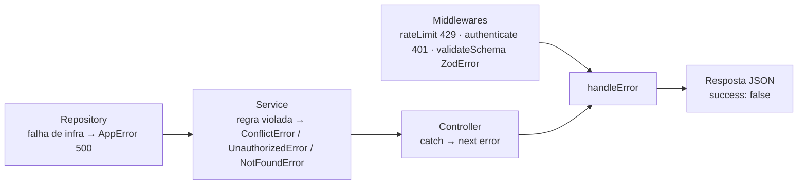

# API — Tratamento de Erros

> **Escopo:** como os erros são criados, propagados e transformados em respostas HTTP no `orcafacil-api`: hierarquia de classes, enum `ErrorCode`, middleware `handleError`, formato das respostas, mapa de status, responsabilidades por camada e como criar novos erros.
> **Documentos relacionados:** [`endpoints.md`](./endpoints.md) (erros por rota) · [`validation.md`](./validation.md) · [`authentication.md`](./authentication.md) · [`../architecture/request-lifecycle.md`](../architecture/request-lifecycle.md#27-tratamento-de-erros--handleerror) · [`../architecture/conventions.md`](../architecture/conventions.md#5-erros)
> **Fonte da verdade:** `src/shared/errors/`, `src/middlewares/handleError.ts`, `src/shared/types/apiResponse.ts`.
> **Última revisão:** 2026-10-15.

---

## 1. Visão geral



Princípios:

1. Erros esperados são **lançados** como instâncias de `AppError` (ou subclasses), sempre com um `ErrorCode`.
2. Nenhuma camada monta resposta de erro manualmente — todas chegam ao **`handleError`** via `throw` ou `next(error)`.
3. O cliente recebe sempre `{ success: false, error, ... }`.

---

## 2. Hierarquia de erros (`src/shared/errors/`)

```
Error
└── AppError (message, statusCode = 400, code?)
    ├── ConflictError      → 409
    ├── UnauthorizedError  → 401
    └── NotFoundError      → 404
```

```ts
export class AppError extends Error{
    public statusCode: number
    public code?: string

    constructor(message: string, statusCode = 400, code?: ErrorCode){
        super(message)
        this.statusCode = statusCode
        this.code = code
    }
}

export class ConflictError extends AppError{
    constructor(message = 'Recurso já existe ou está em conflito', code?: ErrorCode){
        super(message, 409, code)
    }
}
```

| Classe | Status | Mensagem padrão | Quando usar |
|---|---|---|---|
| `AppError` | informado (padrão 400) | — | Falhas de infraestrutura (500), rate limit (429) ou qualquer status sem subclasse. |
| `ConflictError` | 409 | `'Recurso já existe ou está em conflito'` | Duplicidade, cooldown, estado inválido, referência inexistente para a operação. |
| `UnauthorizedError` | 401 | `'Não autorizado'` | Credenciais, tokens, códigos e autorizações inválidos/expirados. |
| `NotFoundError` | 404 | `'Recurso não encontrado'` | Recurso inexistente. (Disponível, mas os módulos atuais usam `ConflictError` para "não encontrado".) |

---

## 3. `ErrorCode` (`src/shared/errors/ErrorCodes.ts`)

Enum de strings enviado no campo `code` da resposta. **O cliente recebe o valor**, que em alguns casos difere do nome da chave (destacados em negrito).

| Seção | Chave (`ErrorCode.X`) | Valor enviado (`code`) | Status típico | Uso atual |
|---|---|---|---|---|
| AUTH | `USER_ALREADY_EXISTS` | `USER_ALREADY_EXISTS` | 409 | E-mail já cadastrado |
| AUTH | `INVALID_CODE` | `INVALID_CODE` | 401 | Código de verificação incorreto |
| AUTH | **`EXPIRED_CODE`** | **`INVALID_OR_EXPIRED_CODE`** | 401 | Código/processo não encontrado no Redis |
| AUTH | `SEND_EMAIL_CODE_ERROR` | `SEND_EMAIL_CODE_ERROR` | 500 | Falha no envio de e-mail |
| AUTH | `LIMIT_ATTEMPTS` | `LIMIT_ATTEMPTS` | 409 / 401 | Cooldown ativo / 5 tentativas de recuperação |
| AUTH | `TIME_OUT_REGISTER` | `TIME_OUT_REGISTER` | 409 | Cadastro pendente expirou |
| AUTH | `INVALID_CREDENTIALS` | `INVALID_CREDENTIALS` | 401 | Login ou e-mail de recuperação inválido |
| AUTH | `INVALID_TOKEN` | `INVALID_TOKEN` | 401 | Refresh token ou `tokenUUID` inválido |
| AUTH | `TOKEN_EXPIRED` | `TOKEN_EXPIRED` | 401 | Refresh token expirado |
| AUTH | `UNAUTHORIZED_USER` | `UNAUTHORIZED_USER` | 401 | Access token ausente/inválido; recuperação não autorizada |
| DATABASE | **`CREATE_DATABASE_ERROR`** | **`DATABASE_ERROR`** | 500 | Reservado (não utilizado) |
| DATABASE | `UPDATE_DATABASE_ERROR` | `UPDATE_DATABASE_ERROR` | 500 | Falha em update (`users`) |
| DATABASE | `QUERY_DATABASE_ERROR` | `QUERY_DATABASE_ERROR` | 500 | Falha em consulta (`users`) |
| DATABASE | `DELETE_DATABASE_ERROR` | `DELETE_DATABASE_ERROR` | 500 | Reservado (não utilizado) |
| USER | `INVALID_USER` | `INVALID_USER` | 409 | Usuário inexistente (edição de cliente) |
| CLIENTS | `CLIENT_ALREADY_EXISTS` | `CLIENT_ALREADY_EXISTS` | 409 | CPF/CNPJ já cadastrado para o usuário |
| CLIENTS | **`INVALID_CLIENT`** | **`INVALID_ID_CLIENT`** | 409 | Cliente não encontrado |
| SELLERS | `SELLER_NOT_EXISTS` | `SELLER_NOT_EXISTS` | — | Legado (módulo de vendedores removido) |
| SYSTEM | `USER_CREATION_FAILED` | `USER_CREATION_FAILED` | 500 | Falha ao inserir usuário |
| SYSTEM | `INTERNAL_SERVER_ERROR` | `INTERNAL_SERVER_ERROR` | 500 | Falha genérica (repositório de clientes, tokens) |
| SYSTEM | `INTERNAL_HASH_ERROR` | `INTERNAL_HASH_ERROR` | 500 | Reservado (não utilizado) |
| SYSTEM | `RATE_LIMIT_EXCEEDED` | `RATE_LIMIT_EXCEEDED` | 429 | Rate limit excedido |
| REDIS | `REDIS_SAVE_ERROR` | `REDIS_SAVE_ERROR` | 500 | Falha em `SET` / `EXISTS` |
| REDIS | `REDIS_GET_ERROR` | `REDIS_GET_ERROR` | 500 | Falha em `GET` |
| REDIS | `REDIS_DEL_ERROR` | `REDIS_DEL_ERROR` | 500 | Falha em `DEL` |

---

## 4. Middleware `handleError`

Arquivo: `src/middlewares/handleError.ts`. Registrado **por último** em `src/index.ts` (`app.use(handleError)`).

```ts
export function handleError(error: any, req, res, next){
    if(error instanceof ZodError){
        return res.status(400).json({
            success: false,
            error: 'Erro de validação',
            details: error.issues.map(issue => ({ field: issue.path.join('.'), message: issue.message }))
        })
    }

    if(error instanceof AppError){
        return res.status(error.statusCode).json({ success: false, error: error.message, code: error.code })
    }

    return res.status(500).json({ success: false, error: 'Erro interno do servidor' })
}
```

| Erro recebido | Status | Corpo |
|---|---|---|
| `ZodError` | 400 | `{ success: false, error: 'Erro de validação', details: [{ field, message }] }` |
| `AppError` e subclasses | `statusCode` do erro | `{ success: false, error: message, code }` (`code` omitido se não informado) |
| Qualquer outro (`Error`, erro do Prisma não tratado, JSON malformado no body, etc.) | 500 | `{ success: false, error: 'Erro interno do servidor' }` |

Detalhes internos (stack, mensagem original do Prisma/Redis) **não** são enviados ao cliente nem registrados em log.

### Como os erros chegam até ele

- **Controllers:** `try { … } catch (error) { next(error) }`.
- **Middlewares síncronos:** `next(new UnauthorizedError(...))` / `next(error)`.
- **Middlewares assíncronos sem `try/catch`** (ex.: `rateLimit`): o Express 5 encaminha automaticamente promises rejeitadas ao `handleError`.
- **Rotas inexistentes** não chegam ao `handleError`: retornam o 404 padrão do Express.

---

## 5. Formato das respostas de erro

```ts
type ApiResponse<T> =
  | { success: true,  data: T }
  | { success: false, error: string, code?: string, details?: { field: string, message: string }[] }
```

**Regra de negócio (409)**
```json
{ "success": false, "error": "Cliente já cadastrado.", "code": "CLIENT_ALREADY_EXISTS" }
```

**Autenticação (401)**
```json
{ "success": false, "error": "Token não autorizado", "code": "UNAUTHORIZED_USER" }
```

**Rate limit (429)**
```json
{ "success": false, "error": "Limite de requisições excedido", "code": "RATE_LIMIT_EXCEEDED" }
```

**Validação (400)**
```json
{ "success": false, "error": "Erro de validação", "details": [{ "field": "email", "message": "Invalid email address" }] }
```

**Infraestrutura (500)**
```json
{ "success": false, "error": "Erro ao buscar dados do usuário.", "code": "QUERY_DATABASE_ERROR" }
```

**Inesperado (500)**
```json
{ "success": false, "error": "Erro interno do servidor" }
```

O cliente deve tratar erros pelo **`code`** (estável) e exibir o **`error`** (mensagem em português, voltada ao usuário final).

---

## 6. Mapa de status HTTP

| Status | Significado na API | Origem |
|---|---|---|
| 200 | Sucesso (todas as operações) | Controllers |
| 400 | Dados de entrada inválidos | `ZodError` |
| 401 | Não autenticado / credencial, token ou código inválido | `UnauthorizedError` |
| 404 | Recurso não encontrado (`NotFoundError`) ou rota inexistente (Express) | — |
| 409 | Conflito / regra de negócio violada / registro inexistente para a operação | `ConflictError` |
| 429 | Rate limit excedido | `AppError(…, 429)` no `rateLimit` |
| 500 | Falha de infraestrutura ou erro inesperado | `AppError(…, 500)` / fallback do `handleError` |

---

## 7. Responsabilidade de cada camada

| Camada | O que faz com erros | Exemplo |
|---|---|---|
| **Repository** | Envolve cada operação de banco/integração em `try/catch` e relança como `AppError` 500 com código de infraestrutura. Não lança erros de negócio; retorna `null` quando não encontra. | `throw new AppError('Erro ao buscar dados do usuário.', 500, ErrorCode.QUERY_DATABASE_ERROR)` |
| **Service** | Lança erros de negócio (guard clauses). Converte falhas do Redis em `AppError` 500. Em blocos com `catch` amplo, relança `AppError` intactos (`if (error instanceof AppError) throw error`). | `if (oldClient) throw new ConflictError('Cliente já cadastrado.', ErrorCode.CLIENT_ALREADY_EXISTS)` |
| **Controller** | Não trata erros: apenas `next(error)`. | `catch (error) { next(error) }` |
| **Middlewares** | Lançam/encaminham erros de autenticação, rate limit e validação. | `next(new AppError('Limite de requisições excedido', 429, ErrorCode.RATE_LIMIT_EXCEEDED))` |
| **handleError** | Único ponto que transforma erro em resposta HTTP. | — |

### Erros de bibliotecas

| Origem | Tratamento |
|---|---|
| Prisma | Capturado no repositório → `AppError` 500. |
| Redis (`ioredis`) | Capturado no service (ou em `verifyKeyExists`) → `AppError` 500 `REDIS_*_ERROR`. |
| `jsonwebtoken` | `TokenExpiredError` → 401 `TOKEN_EXPIRED`; `JsonWebTokenError` → 401 `INVALID_TOKEN` (no `auth`) ou 401 `UNAUTHORIZED_USER` (no `authenticate`). |
| `nodemailer` | Capturado no `AuthUserRepository` → 500 `SEND_EMAIL_CODE_ERROR`. |
| Zod | Não capturado — o `ZodError` vai direto ao `handleError` (400). |

---

## 8. Como criar novos erros

**Novo código de erro**
1. Adicionar ao enum em `ErrorCodes.ts`, na seção comentada do domínio (crie a seção se for um módulo novo, ex.: `// PRODUCTS`).
2. Preferir valor igual ao nome da chave: `PRODUCT_NOT_FOUND = 'PRODUCT_NOT_FOUND'`.

**Lançar o erro**
```ts
if (!product) throw new NotFoundError('Produto não encontrado.', ErrorCode.PRODUCT_NOT_FOUND)
```
- Escolher a subclasse pelo status (`ConflictError`, `UnauthorizedError`, `NotFoundError`); usar `AppError` para outros status.
- Mensagem em português, curta, adequada para exibir ao usuário.
- Sempre informar um `ErrorCode`.

**Nova classe de erro** (para um status recorrente sem subclasse, ex.: 403)
```ts
// src/shared/errors/ForbiddenError.ts
import { AppError } from "@/shared/errors/AppError";
import { ErrorCode } from "@/shared/errors/ErrorCodes"

export class ForbiddenError extends AppError{
    constructor(message = 'Acesso negado', code?: ErrorCode){
        super(message, 403, code)
    }
}
```
Nenhuma alteração no `handleError` é necessária: qualquer subclasse de `AppError` já é tratada.

**Testar** — nos testes unitários, verificar status e código:
```ts
await expect(Service.metodo(dados)).rejects.toMatchObject({ statusCode: 409, code: ErrorCode.CLIENT_ALREADY_EXISTS })
```
