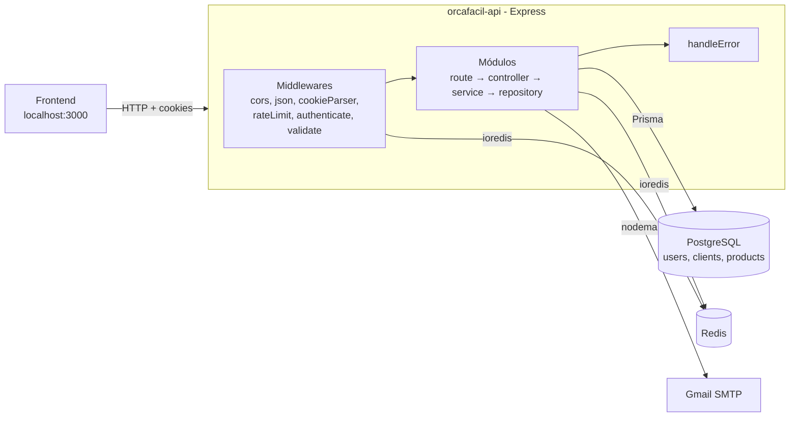

# Arquitetura — Visão Geral

> **Escopo:** resumo da arquitetura do `orcafacil-api`: o que o sistema faz, stack, estilo arquitetural, camadas, componentes de infraestrutura e módulos existentes.
> **Documentos relacionados:**
> - [`folder-structure.md`](./folder-structure.md) — organização de pastas e arquivos.
> - [`request-lifecycle.md`](./request-lifecycle.md) — caminho de uma requisição do início ao fim.
> - [`conventions.md`](./conventions.md) — padrões de código e convenções.
> - [`../database/schema.md`](../database/schema.md) e [`../database/relationships.md`](../database/relationships.md) — banco de dados.
>
> **Fonte da verdade:** código do repositório `orcafacil-api`. Se este documento divergir do código, o código prevalece.
> **Última revisão:** 2026-10-15.

---

## 1. O que é o sistema

O **OrçaFácil** é uma API REST para **gestão de orçamentos e clientes** (vendas estão fora do escopo atual). Cada usuário (empresa ou profissional, identificado por CPF/CNPJ) se cadastra, faz login e gerencia os próprios dados — hoje, clientes; em seguida, produtos, serviços e orçamentos.

É uma API **backend pura** (sem renderização de páginas), consumida por um frontend separado que roda em `http://localhost:3000` em desenvolvimento (origem liberada no CORS).

---

## 2. Stack

| Camada | Tecnologia | Uso no projeto |
|---|---|---|
| Runtime | Node.js (20 no Docker, 24 no CI) | Execução da API |
| Linguagem | TypeScript 5 (`strict`, CommonJS, ES2020) | Todo o código em `src/` e `tests/` |
| Framework HTTP | Express 5 | Rotas, middlewares, tratamento de erros |
| Validação | Zod 4 | Schemas de entrada (body/query) |
| ORM | Prisma 7 + `@prisma/adapter-pg` | Acesso ao PostgreSQL |
| Banco relacional | PostgreSQL (15 em dev/CI, 17 em prod) | Dados persistentes (usuários, clientes, produtos) |
| Banco em memória | Redis + `ioredis` | Rate limit, códigos de verificação, refresh tokens, recuperação de senha |
| Autenticação | `jsonwebtoken` (JWT) + cookies `httpOnly` | Access token (15 min) e refresh token (7 dias) |
| Hash | `argon2` (Argon2id + pepper) | Senhas e códigos de verificação |
| E-mail | `nodemailer` (Gmail) | Envio de códigos de verificação |
| CPF/CNPJ | `cpf-cnpj-validator` | Validação de documentos |
| Testes | Vitest | Testes unitários dos services |
| Lint | ESLint 10 + `typescript-eslint` | Padronização de código |
| Containers | Docker / Docker Compose | Ambientes de dev e prod |
| CI | Bitbucket Pipelines | Validação de pull requests |

---

## 3. Estilo arquitetural

### Arquitetura em camadas (Layered Architecture), organizada por módulo de domínio

O código é dividido em **módulos por domínio** (`auth`, `user`, `clients`, …) dentro de `src/modules/`. Dentro de cada módulo, a responsabilidade é separada em **camadas**, sempre na mesma direção:

```
Route  →  Controller  →  Service  →  Repository  →  Prisma / Redis / Nodemailer
  │            │             │             │
  │            │             │             └─ acesso a dados e serviços externos
  │            │             └─ regras de negócio
  │            └─ adaptação HTTP (req/res)
  └─ endpoint + cadeia de middlewares
```

| Camada | Arquivo | Responsabilidade | Não deve |
|---|---|---|---|
| **Route** | `*.route.ts` | Define método + caminho e encadeia middlewares (`rateLimit`, `authenticate`, `validateSchema`) até o controller. | Conter lógica. |
| **Controller** | `*.controller.ts` | Lê `req` (body, params, query, cookies, `req.user`), chama o service, monta a resposta `ApiResponse`, seta cookies e repassa erros com `next(error)`. | Ter regra de negócio ou acessar o banco. |
| **Service** | `*.service.ts` | Regras de negócio: verificações de existência/conflito, hash, geração de códigos e tokens, orquestração de repositórios e Redis. Lança erros de domínio (`ConflictError`, `UnauthorizedError`…). | Conhecer `req`/`res` do Express. |
| **Repository** | `*.repository.ts` | Acesso a dados (Prisma) e integrações externas (ex.: envio de e-mail). Converte falhas de infraestrutura em `AppError` 500. | Conter regras de negócio. |

Arquivos de apoio de cada módulo:

| Arquivo | Conteúdo |
|---|---|
| `*.schema.ts` | Schemas Zod de validação da entrada. |
| `*.dtos.ts` | Formatos de entrada/saída da API (Request/Response DTOs). |
| `*.types.ts` | Tipos internos usados entre service e repository. |

### Código transversal

- **`src/middlewares/`** — middlewares reutilizáveis: autenticação, rate limit, validação e tratamento global de erros.
- **`src/shared/`** — erros customizados, tipos globais e utilitários (hash, tokens, cookies, geração de código, validação de CPF/CNPJ).
- **`src/lib/`** — clientes de infraestrutura instanciados uma única vez (`prisma`, `redis`).

Detalhes em [`folder-structure.md`](./folder-structure.md).

---

## 4. Componentes de infraestrutura



| Componente | Papel | Configuração |
|---|---|---|
| **PostgreSQL** | Dados persistentes de negócio. | `DATABASE_URL` · ver [`../database/schema.md`](../database/schema.md) |
| **Redis** | Dados temporários com TTL: contadores de rate limit, cadastros pendentes de confirmação, cooldown de reenvio, whitelist de refresh tokens e fluxo de recuperação de senha. | `REDIS_HOST`, `REDIS_PORT` |
| **Gmail SMTP** | Envio dos códigos de 6 dígitos (cadastro e recuperação de senha). | `USER_EMAIL`, `USER_PASSWORD` |

### Variáveis de ambiente

| Variável | Uso |
|---|---|
| `PORT` | Porta HTTP (padrão `3000`). |
| `NODE_ENV` | `production` ativa `secure` nos cookies e desativa o cache global do Prisma Client. |
| `DATABASE_URL` | Conexão do Prisma com o PostgreSQL. |
| `DATABASE_USER`, `DATABASE_PASSWORD`, `DATABASE_NAME` | Usadas pelo `docker-compose.dev.yml` para subir o PostgreSQL. |
| `REDIS_HOST`, `REDIS_PORT` | Conexão com o Redis. |
| `JWT_ACCESS_SECRET`, `JWT_REFRESH_SECRET` | Assinatura dos tokens de acesso e refresh. |
| `PEPPER` | Pepper concatenado aos valores antes do hash Argon2. |
| `USER_EMAIL`, `USER_PASSWORD` | Credenciais do remetente no Nodemailer. |

---

## 5. Autenticação (resumo)

- **Cadastro em duas etapas:** `POST /user/auth/email/verify` guarda o cadastro pendente no Redis e envia um código por e-mail; `POST /user/auth/email/confirm` valida o código e cria o registro em `users`.
- **Login:** gera um **access token** (JWT, 15 min, `sub = userId`) e um **refresh token** (JWT, 7 dias, `sub` + `jti`). Os dois são enviados como **cookies `httpOnly`, `sameSite=strict`** — nunca no corpo da resposta.
- **Sessões:** o `jti` de cada refresh token válido fica no Redis (`refresh-token-{jti}`). O refresh faz **rotação** (apaga o antigo e cria um novo); o logout apaga a chave.
- **Rotas protegidas:** o middleware `authenticate` lê o cookie `accessToken`, valida o JWT e coloca o id do usuário em `req.user`.
- **Recuperação de senha:** fluxo em três etapas (enviar código → confirmar código → nova senha) controlado por um `tokenUUID` no Redis, com limite de 5 tentativas.

Fluxo detalhado em [`request-lifecycle.md`](./request-lifecycle.md).

---

## 6. Módulos e endpoints atuais

| Módulo | Prefixo | Status | Endpoints |
|---|---|---|---|
| `auth` | `/user/auth` | Implementado | `POST /email/verify`, `POST /email/confirm`, `POST /email/resend-email-code`, `POST /login`, `POST /refresh-token`, `POST /password-recovery/send-code`, `POST /password-recovery/confirm-code`, `POST /password-recovery/new-password`, `POST /logout` |
| `user` | `/user` | Esqueleto (router, controller e service vazios); o `user.repository.ts` é usado pelo `auth` e pelo `clients` | — |
| `clients` | `/clients` | Implementado (rotas protegidas) | `POST /create`, `PATCH /edit/:id`, `DELETE /delete/:id`, `GET /`, `GET /:id` |
| `products` | — | Planejado (tabela `products` já existe; trabalho na branch `features/products`) | — |

Documentação externa dos endpoints (Postman): https://documenter.getpostman.com/view/53399164/2sBXqDsiVE

---

## 7. Ambientes, build e CI

| Ambiente | Como roda |
|---|---|
| **Desenvolvimento** | `npm run dev:docker:up` sobe PostgreSQL 15 e Redis 7 (`docker-compose.dev.yml`); a API roda no host com `npm run dev` (`ts-node-dev`, hot reload, `tsconfig-paths`). |
| **Build** | `npm run build` → `tsc -p tsconfig.build.json` + `tsc-alias` (resolve o alias `@/`) → saída em `dist/`. |
| **Produção** | `Dockerfile` multi-stage (`node:20-alpine`): gera o Prisma Client, compila e executa `node dist/index.js` na porta 3000. `docker-compose.prod.yml` sobe API + PostgreSQL 17 + Redis 8 (com AOF) numa rede `orcafacil`, lendo `.env.prod`. |
| **CI** | `bitbucket-pipelines.yml`, em todo pull request: sobe PostgreSQL e Redis, `npm install` → `prisma generate` → `prisma migrate deploy` → testes unitários → build. |

Repositório remoto: Bitbucket (`bitbucket.org/orcafacil-api/orcafacil-api`), com fluxo de pull requests.
