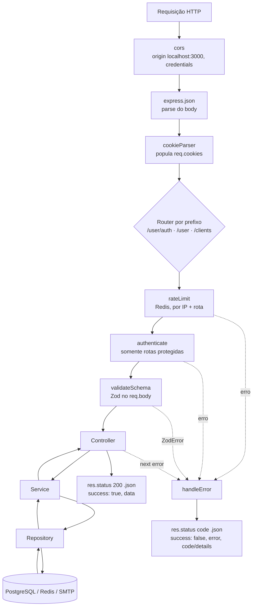
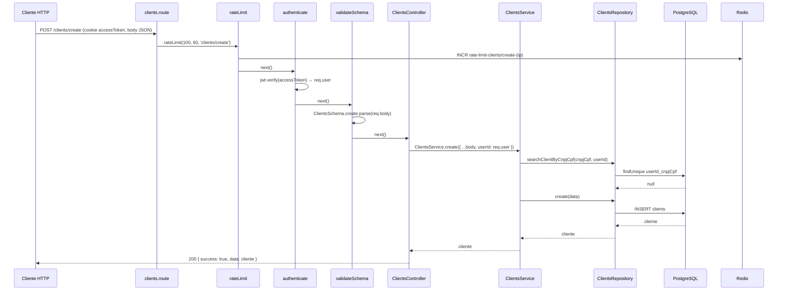
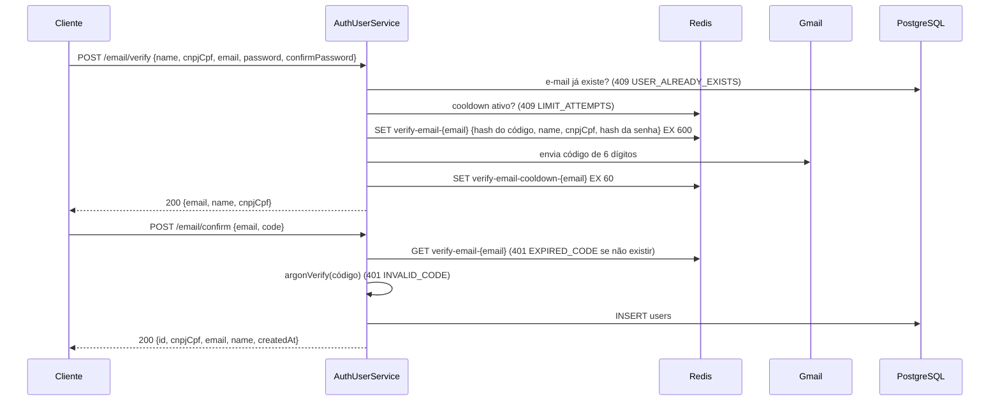
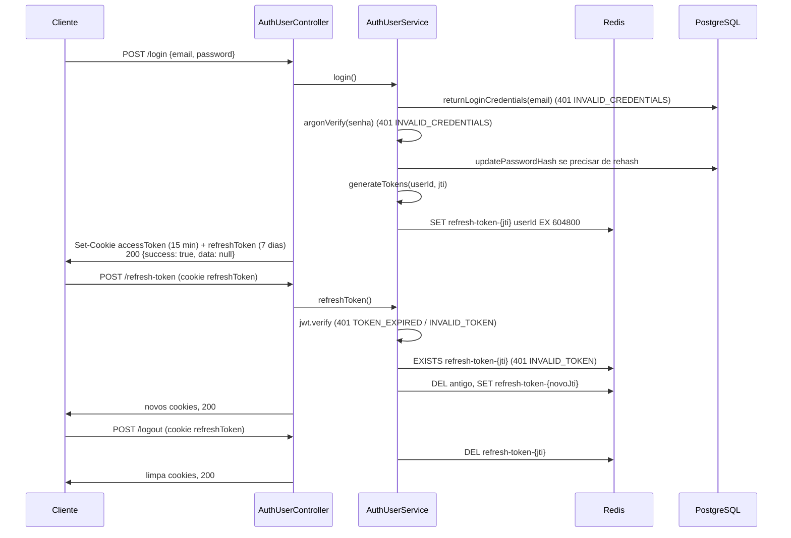

# Arquitetura — Ciclo de Vida das Requisições

> **Escopo:** o caminho de uma requisição HTTP no `orcafacil-api`, da entrada no Express até a resposta: middlewares globais, cadeia de middlewares por rota, camadas do módulo, formato da resposta e tratamento de erros. Inclui os fluxos de autenticação.
> **Documentos relacionados:** [`overview.md`](./overview.md) · [`folder-structure.md`](./folder-structure.md) · [`conventions.md`](./conventions.md)
> **Fonte da verdade:** `src/index.ts`, `src/middlewares/`, `src/modules/*/`.
> **Última revisão:** 2026-10-16.

---

## 1. Visão geral do pipeline



Toda resposta, de sucesso ou de erro, segue o tipo `ApiResponse<T>` (`src/shared/types/apiResponse.ts`).

---

## 2. Etapa por etapa

### 2.1 Middlewares globais (`src/index.ts`)

Executados em **todas** as requisições, nesta ordem:

| Ordem | Middleware | Efeito |
|---|---|---|
| 1 | `cors({ origin: 'http://localhost:3000', credentials: true })` | Libera o frontend e permite o envio de cookies. |
| 2 | `express.json()` | Converte o body JSON em `req.body`. |
| 3 | `cookieParser()` | Popula `req.cookies` (onde ficam `accessToken` e `refreshToken`). |

### 2.2 Roteamento por prefixo

| Prefixo | Router | Arquivo |
|---|---|---|
| `/user/auth` | `AuthUserRoutes` | `src/modules/auth/auth.route.ts` |
| `/user` | `UserRoutes` | `src/modules/user/user.route.ts` |
| `/clients` | `ClientsRoutes` | `src/modules/clients/clients.route.ts` |

`/user/auth` é registrado **antes** de `/user`. Rota inexistente cai no 404 padrão do Express (não passa pelo `ApiResponse`).

### 2.3 Cadeia de middlewares da rota

Cada rota declara sua cadeia na seguinte ordem fixa:

```ts
Router.metodo('/caminho', rateLimit(max, janelaSeg, 'modulo/acao'), [authenticate], [validateSchema(schema)], Controller.metodo)
```

**a) `rateLimit(maxReqLimit, maxTimeLimit, route)`** — `src/middlewares/rateLimit.ts`
- Identifica o cliente pelo IP (`x-forwarded-for` → `req.socket.remoteAddress` → `req.ip`).
- Incrementa a chave Redis `rate-limit-{route}-{ip}`; na primeira requisição define o TTL de `maxTimeLimit` segundos (janela fixa).
- Acima de `maxReqLimit` → `AppError` **429** `RATE_LIMIT_EXCEEDED`.
- Roda **antes** da autenticação, então protege também rotas públicas.

**b) `authenticate`** — `src/middlewares/authenticate.ts` (apenas rotas protegidas; hoje, todas de `/clients`)
- Lê `req.cookies.accessToken`. Ausente → `UnauthorizedError` **401** `UNAUTHORIZED_USER`.
- `jwt.verify` com `JWT_ACCESS_SECRET`. Inválido/expirado → **401** `UNAUTHORIZED_USER`.
- Sucesso → `req.user = payload.sub` (id do usuário como **string**; o controller converte com `Number(req.user)`).

**c) `validateSchema(schema)`** — `src/middlewares/validate.ts`
- `req.body = schema.parse(req.body)`: valida e **substitui** o body pelo resultado do parse (campos não declarados no schema são descartados).
- Falha → o `ZodError` vai para o `handleError` → **400**.
- Valida **apenas o body**. Query strings são validadas dentro do controller (ex.: `ClientsSchema.getAllQuery.parse(req.query)` em `ClientsController.getAll`), e o erro segue pelo mesmo `next(error)`.

### 2.4 Controller

```ts
static async metodo(req: Request, res: Response<ApiResponse<DTO>>, next: NextFunction) {
    try {
        const result = await Service.metodo(/* dados extraídos de req */)
        return res.status(200).json({ success: true, data: result })
    } catch (error) {
        next(error)
    }
}
```

- Extrai dados de `req.body`, `req.params` (convertidos com `Number(id)`), `req.query`, `req.cookies` ou `req.user`.
- Chama **um** método do service.
- Responde sempre **200** em caso de sucesso, com `{ success: true, data }`. Quando não há conteúdo, `data: null`.
- Em autenticação, manipula cookies com `AuthCookies.setAuthCookies(res, tokens)` / `AuthCookies.clearAuthCookies(res)`.
- Qualquer erro é repassado com `next(error)`.

### 2.5 Service

- Executa as regras de negócio em sequência, com **early return por exceção**: cada verificação que falha lança um erro de domínio (`ConflictError` 409, `UnauthorizedError` 401, `NotFoundError` 404 ou `AppError`).
- Usa repositórios para o PostgreSQL, `redis` diretamente para dados temporários e utilitários de `src/shared/utils`.
- Operações com Redis ficam em `try/catch` e convertem falhas em `AppError` 500 (`REDIS_SAVE_ERROR`, `REDIS_GET_ERROR`, `REDIS_DEL_ERROR`).

### 2.6 Repository

- Executa a query Prisma (ou a integração externa) dentro de `try/catch`.
- Qualquer falha de infraestrutura vira `AppError` **500** com um `ErrorCode` de banco/sistema (`QUERY_DATABASE_ERROR`, `UPDATE_DATABASE_ERROR`, `USER_CREATION_FAILED`, `INTERNAL_SERVER_ERROR`, `SEND_EMAIL_CODE_ERROR`).
- Retorna o objeto do banco (ou `null` em buscas sem resultado). Em `users`, usa `select` explícito para nunca expor `password`, exceto no método de login.

### 2.7 Tratamento de erros — `handleError`

Registrado por último em `src/index.ts`. Recebe tudo o que foi passado a `next(error)` e também promises rejeitadas de middlewares assíncronos (o Express 5 encaminha automaticamente).

| Tipo do erro | Status | Corpo da resposta |
|---|---|---|
| `ZodError` | 400 | `{ success: false, error: 'Erro de validação', details: [{ field, message }] }` |
| `AppError` (e subclasses) | `error.statusCode` | `{ success: false, error: error.message, code: error.code }` |
| Qualquer outro | 500 | `{ success: false, error: 'Erro interno do servidor' }` |

---

## 3. Formato das respostas

```ts
type ApiResponse<T> =
  | { success: true,  data: T }
  | { success: false, error: string, code?: string, details?: { field: string, message: string }[] }
```

**Sucesso**
```json
{ "success": true, "data": { "id": 1, "name": "Cliente X", "cnpjCpf": "12345678909" } }
```

**Erro de domínio**
```json
{ "success": false, "error": "Cliente já cadastrado.", "code": "CLIENT_ALREADY_EXISTS" }
```

**Erro de validação**
```json
{ "success": false, "error": "Erro de validação", "details": [{ "field": "cnpjCpf", "message": "CPF ou CNPJ inválido" }] }
```

---

## 4. Exemplo completo — `POST /clients/create`



Se o CPF/CNPJ já existir para o usuário, o service lança `ConflictError('Cliente já cadastrado.', CLIENT_ALREADY_EXISTS)` → `handleError` → **409**.

---

## 5. Fluxos de autenticação

Todas as rotas abaixo ficam sob `/user/auth`, são **públicas** (sem `authenticate`) e têm rate limit próprio.

| Rota | Rate limit (req / 60 s) | Body validado |
|---|---|---|
| `POST /email/verify` | 2 | `verifyEmailSchema` |
| `POST /email/confirm` | 5 | `confirmEmailSchema` |
| `POST /email/resend-email-code` | 1 | `resendCodeEmailSchema` |
| `POST /login` | 5 | `loginSchema` |
| `POST /refresh-token` | 10 | — (usa cookie) |
| `POST /password-recovery/send-code` | 1 | `sendCodeRecoverySchema` |
| `POST /password-recovery/confirm-code` | 10 | `confirmCodeRecoverySchema` |
| `POST /password-recovery/new-password` | 3 | `createNewPasswordSchema` |
| `POST /logout` | 1 | — (usa cookie) |

### 5.1 Cadastro (verificação de e-mail)



`POST /email/resend-email-code` respeita o cooldown, reaproveita o cadastro pendente do Redis com um novo código e renova o TTL.

### 5.2 Login, refresh e logout



**Cookies** (`src/shared/utils/AuthCookies.ts`): `httpOnly`, `sameSite: 'strict'`, `secure` apenas quando `NODE_ENV === 'production'`. Os tokens **nunca** vão no corpo da resposta.

**Tokens** (`src/shared/utils/generateTokens.ts`):
- Access: `{ sub: userId }`, `JWT_ACCESS_SECRET`, `expiresIn: '15m'`.
- Refresh: `{ sub: userId, jti }`, `JWT_REFRESH_SECRET`, `expiresIn: '7d'`. Só é aceito se o `jti` estiver no Redis.

### 5.3 Recuperação de senha

```mermaid
sequenceDiagram
    participant C as Cliente
    participant S as AuthUserService
    participant RD as Redis
    participant DB as PostgreSQL

    C->>S: POST /password-recovery/send-code {email}
    S->>DB: findByEmail (401 INVALID_CREDENTIALS)
    S->>RD: SET recovery-password-{uuid} {id, hash do código, authorized: false, attempts: 0} EX 600
    S-->>C: 200 {tokenUUID}  (+ código por e-mail)

    C->>S: POST /password-recovery/confirm-code {tokenUUID, code}
    S->>RD: GET (401 EXPIRED_CODE); attempts ≥ 5 → DEL + 401 LIMIT_ATTEMPTS
    S->>RD: attempts += 1 (KEEPTTL)
    S->>S: argonVerify(código) (401 INVALID_CODE)
    S->>RD: SET recovery-password-{novoUuid} {..., authorized: true} EX 600, DEL antigo
    S-->>C: 200 {tokenUUID: novoUuid}

    C->>S: POST /password-recovery/new-password {tokenUUID, newPassword, confirmNewPassword}
    S->>RD: GET (401 INVALID_TOKEN); authorized? (401 UNAUTHORIZED_USER)
    S->>DB: updatePasswordHash(argonHash(newPassword))
    S-->>C: 200 {data: null}
```

---

## 6. Resumo: quem faz o quê em cada requisição

| Pergunta | Onde |
|---|---|
| A requisição excedeu o limite? | `rateLimit` (Redis) |
| O usuário está autenticado? Quem é? | `authenticate` → `req.user` |
| O body é válido? | `validateSchema` + `{modulo}.schema.ts` |
| A query string é válida? | Controller, com `Schema.parse(req.query)` |
| A operação é permitida pelas regras de negócio? | Service |
| Como o dado é lido/gravado? | Repository (Prisma) ou Service (Redis) |
| Qual status e formato de resposta? | Controller (sucesso) / `handleError` (erro) |
