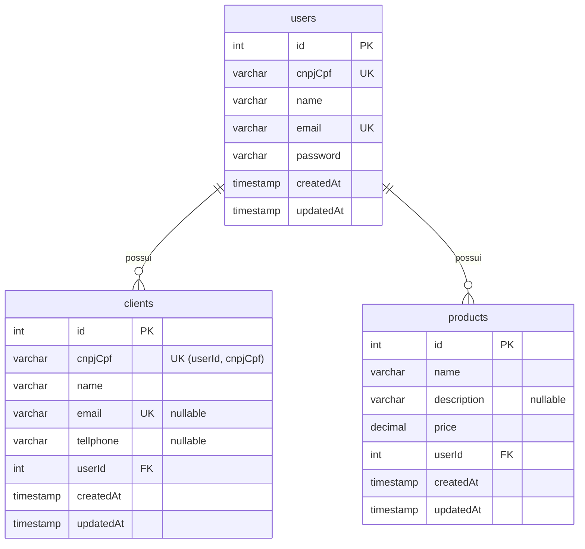

# Banco de Dados — Relacionamentos

> **Escopo:** relações entre as tabelas do `orcafacil-api`: cardinalidade, chaves estrangeiras, comportamento em delete/update, regras de isolamento por usuário (multi-tenant) e como consultar dados relacionados com o Prisma.
> **Estrutura das tabelas e colunas:** ver [`schema.md`](./schema.md).
> **Fonte da verdade:** `prisma/schema.prisma` e `prisma/migrations/` no repositório `orcafacil-api`.
> **Última revisão:** 2026-10-16 (migration mais recente: `20260907203920_removido_sellers_e_services`).

---

## 1. Visão geral

O modelo é uma **estrela centrada em `users`**: todo dado de negócio pertence a exatamente um usuário. Não existem relações diretas entre `clients` e `products` (ainda não há tabela de orçamentos/vendas que os conecte).



### Resumo das relações

| Relação | Cardinalidade | FK (lado filho) | Constraint | ON DELETE | ON UPDATE | Obrigatória |
|---|---|---|---|---|---|---|
| `users` → `clients` | 1 : N | `clients.userId` → `users.id` | `clients_userId_fkey` | `RESTRICT` | `CASCADE` | sim |
| `users` → `products` | 1 : N | `products.userId` → `users.id` | `products_userId_fkey` | `RESTRICT` | `CASCADE` | sim |

---

## 2. Relações em detalhe

### 2.1 `users` 1 : N `clients`

- **Um usuário** tem **zero ou mais clientes**; **um cliente** pertence a **exatamente um usuário**.
- Declaração no Prisma:
  - Em `User`: `clients Client[]` (campo virtual, não existe coluna).
  - Em `Client`: `user User @relation(fields: [userId], references: [id])` + `userId Int`.
- SQL gerado:
  ```sql
  ALTER TABLE "clients" ADD CONSTRAINT "clients_userId_fkey"
    FOREIGN KEY ("userId") REFERENCES "users"("id")
    ON DELETE RESTRICT ON UPDATE CASCADE;
  ```
- **Unicidade dependente da relação:** `@@unique([userId, cnpjCpf])` → índice `clients_userId_cnpjCpf_key`. O CPF/CNPJ de um cliente é único **dentro do escopo do usuário**, não globalmente. No Prisma Client, essa chave composta é acessada como `userId_cnpjCpf`:
  ```ts
  prisma.client.findUnique({
    where: { userId_cnpjCpf: { userId, cnpjCpf } }
  })
  ```
- Esse índice composto começa por `userId`, então também atende às consultas `WHERE "userId" = ?` (listagem de clientes do usuário).

### 2.2 `users` 1 : N `products`

- **Um usuário** tem **zero ou mais produtos**; **um produto** pertence a **exatamente um usuário**.
- Declaração no Prisma:
  - Em `User`: `products Product[]`.
  - Em `Product`: `user User @relation(fields: [userId], references: [id])` + `userId Int`.
- SQL gerado:
  ```sql
  ALTER TABLE "products" ADD CONSTRAINT "products_userId_fkey"
    FOREIGN KEY ("userId") REFERENCES "users"("id")
    ON DELETE RESTRICT ON UPDATE CASCADE;
  ```
- Não há restrição de unicidade composta (o mesmo usuário pode ter dois produtos com o mesmo nome).
- **Não há índice dedicado em `products.userId`** — considerar `@@index([userId])` quando o módulo de produtos for implementado.

---

## 3. Comportamento referencial

Nenhuma relação define `onDelete`/`onUpdate` explicitamente no `schema.prisma`, então valem os **padrões do Prisma para relações obrigatórias**:

| Ação | Efeito |
|---|---|
| Excluir um `User` que tem clientes ou produtos | **Falha** (`RESTRICT`). O Prisma lança erro `P2003` (foreign key constraint failed). É preciso excluir/transferir os filhos antes. |
| Excluir um `Client` ou `Product` | Permitido; não afeta o usuário. |
| Alterar `users.id` | Propaga para `clients.userId` e `products.userId` (`CASCADE`). Na prática `id` é `SERIAL` e não é alterado. |
| Criar `Client`/`Product` com `userId` inexistente | **Falha** com `P2003`. |

> Se no futuro for necessário excluir uma conta com todos os dados, a decisão deve ser explícita: ou `onDelete: Cascade` nas relações, ou uma exclusão em transação (`prisma.$transaction`) apagando filhos antes do usuário.

---

## 4. Isolamento por usuário (multi-tenant)

A relação com `users` é o que garante que um usuário só veja os próprios dados. O banco **não** impõe isso sozinho (não há Row Level Security); o isolamento depende de **toda query filtrar por `userId`**.

### Origem do `userId`

- O middleware `authenticate` (`src/middlewares/authenticate.ts`) valida o cookie `accessToken` (JWT) e grava o `sub` (id do usuário, como `string`) em `req.user`.
- O `userId` confiável é **sempre `Number(req.user)`** — nunca um valor vindo de `req.body`, `req.query` ou `req.params`.

### Regras para código novo

1. **Criar:** preencher `userId` a partir de `req.user` (ex.: `ClientsController.create` chama `ClientsService.create({ ...data, userId: Number(req.user) })`; o schema de criação não aceita `userId`).
2. **Listar:** `where: { userId, ...filtros }`.
3. **Buscar/editar/excluir por `id`:** filtrar por `id` **e** `userId` (ex.: `findFirst({ where: { id, userId } })`, `updateMany`/`deleteMany` com `{ id, userId }`, ou buscar e comparar `registro.userId` antes de agir). Se não pertencer ao usuário, responder como "não encontrado". Referência: `ClientsRepository.searchClientById(id, userId)` + `NotFoundError` em `ClientsService`.
4. **Unicidade por usuário:** usar chaves compostas `(userId, campo)` em vez de `@unique` global.

### Estado atual do módulo `clients`

| Operação | Filtra por usuário? | Observação |
|---|---|---|
| `GET /clients` (`getAll`) | Sim | Usa `req.user`. |
| `POST /clients/create` | Parcial | Usa `userId` vindo do **body** (validado pelo Zod), não de `req.user` — um usuário autenticado pode criar clientes em nome de outro. |
| `PATCH /clients/edit/:id` | Não | `userId` vem do body e o `update` usa só `where: { id }`. |
| `DELETE /clients/delete/:id` | Não | Busca e exclui apenas por `id`. |
| `GET /clients/:id` | Não | Busca apenas por `id`. |

Essas lacunas devem ser corrigidas antes de replicar o padrão para outros módulos (ex.: `products`).

---

## 5. Consultas relacionadas com Prisma

```ts
// Clientes de um usuário (com filtro opcional)
prisma.client.findMany({ where: { userId, name: 'Fulano' } })

// Usuário com seus clientes e produtos (nunca selecionar password)
prisma.user.findUnique({
  where: { id: userId },
  select: {
    id: true, name: true, email: true, cnpjCpf: true,
    clients: true,
    products: true,
  },
})

// Cliente com o dono
prisma.client.findFirst({
  where: { id, userId },
  include: { user: { select: { id: true, name: true } } },
})

// Contagem de filhos por usuário
prisma.user.findUnique({
  where: { id: userId },
  select: { _count: { select: { clients: true, products: true } } },
})

// Criar vinculando pela relação (equivalente a passar userId)
prisma.product.create({
  data: { name, price, user: { connect: { id: userId } } },
})
```

---

## 6. Relações removidas (histórico)

Já existiram relações que **não fazem mais parte do modelo** (removidas em `20260907203920_removido_sellers_e_services`):

| Relação antiga | Detalhe |
|---|---|
| `users` 1 : N `sellers` | Vendedores do usuário (`sellers.userId`, `ON DELETE RESTRICT`), com CPF/CNPJ único por usuário e `comissionRate`. |
| `sellers` 1 : N `clients` | `clients.sellerId` opcional, `ON DELETE SET NULL` (cliente atendido por um vendedor). |
| `users` 1 : N `services` | Serviços com preço (`services.userId`, `ON DELETE RESTRICT`). |

Não reintroduza essas tabelas ou a coluna `clients.sellerId` sem uma decisão explícita.

---

## 7. Evolução esperada

O domínio do sistema (orçamentos, clientes e vendas) indica que as próximas tabelas devem relacionar `clients` e `products` — por exemplo, um orçamento (`budgets`) pertencente a um usuário e a um cliente, com itens (`budget_items`) que referenciam produtos (N : N entre orçamentos e produtos via tabela de itens, guardando quantidade e preço unitário no momento do orçamento). Ao criar essas tabelas:

- incluir `userId` com relação para `users` (isolamento por usuário);
- definir `onDelete` explicitamente em cada relação;
- adicionar `@@index` nas FKs usadas em filtros;
- atualizar este documento e o `schema.md`.
