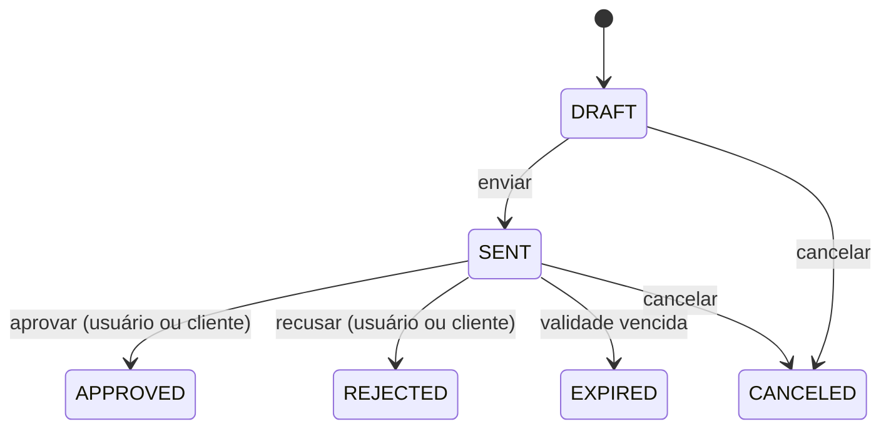

# Domínio — Especificação: Orçamentos

> **Escopo:** especificação funcional do módulo de **orçamentos** (Fase 5 do [roadmap](./roadmap.md#fase-5--orçamentos)): ciclo de vida, campos, itens, cálculos, numeração, edição, busca, endpoints, erros e modelo de dados. O envio ao cliente (PDF, e-mail, link, WhatsApp) é das fases 6 e 7 e só aparece aqui no que afeta o orçamento.
> **Documentos relacionados:** [`business-rules.md`](./business-rules.md#6-orçamentos-regras-transversais) · [`products.md`](./products.md) · [`services.md`](./services.md) · [`roadmap.md`](./roadmap.md) · [`glossary.md`](./glossary.md)
> **Fonte da verdade:** especificação validada pelo responsável pelo produto em 2026-10-16. Ao implementar, o módulo ganha também `modules/budgets.md`, com a documentação técnica.
> **Última revisão:** 2026-10-16.

---

## Status

Tudo neste documento está 🔵 **Aprovado** e ainda **não implementado**: não existe código nem tabela de orçamentos. Ao implementar, as regras passam a ✅.

---

## 1. Objetivo

Permitir que o usuário monte **propostas comerciais** para seus clientes, com produtos e serviços do catálogo, quantidades, preços e condições, e acompanhe a situação de cada uma (rascunho, enviada, aprovada, recusada...).

Fora do escopo desta versão: condições de pagamento e prazo de entrega estruturados, item avulso (fora do catálogo), orçamento sem cliente cadastrado, edição depois do envio e duplicação de orçamento (ver [Decisões](#13-decisões)).

### Regras transversais que este módulo implementa

| Regra | Resumo |
|---|---|
| RN-O01 | Orçamento pertence a um usuário e é emitido para um **cliente cadastrado** desse usuário (BD3). |
| RN-O02 | Itens só usam produtos e serviços do catálogo do mesmo usuário; **não há item avulso** (BD2). |
| RN-O03 | Só pode ser enviado com pelo menos um item. |
| RN-O04 | Nome e preço do produto/serviço são copiados para o item (snapshot) e podem ser ajustados no item. |
| RN-O05 | Número sequencial por usuário, nunca reutilizado. |
| RN-O06 | Nenhum desconto deixa item ou total negativo. |
| RN-G09 / RN-G10 | Valores em BRL, 2 casas, arredondamento comercial item a item. |
| RN-G12 | Datas de negócio no fuso `America/Sao_Paulo`. |
| RN-G13 | Depois de enviado, o orçamento preserva os valores do momento. |
| RN-C09 / RN-P05 / RN-S09 | Clientes, produtos e serviços usados em orçamentos só podem ser inativados. |
| RN-P09 / RN-S08 | Produtos e serviços inativos não podem ser adicionados. |
| RN-S11 | Serviço "a combinar" entra sem preço; o valor pode ser informado no item. |

---

## 2. Ciclo de vida (status)

| Status | Significado | Pode editar? |
|---|---|---|
| `DRAFT` — Rascunho | Em elaboração; ainda não foi enviado ao cliente. | Sim |
| `SENT` — Enviado | Entregue ao cliente, aguardando resposta. | **Não** (RN-O26) |
| `APPROVED` — Aprovado | Cliente aceitou. | Não |
| `REJECTED` — Recusado | Cliente recusou. | Não |
| `EXPIRED` — Expirado | Passou da validade sem resposta. | Não |
| `CANCELED` — Cancelado | Desistência do próprio usuário. | Não |



**RN-O07 — Transições permitidas.** Só as transições do diagrama são válidas; qualquer outra retorna erro. `APPROVED`, `REJECTED`, `EXPIRED` e `CANCELED` são **finais**.

**RN-O08 — Expiração automática.** Um orçamento `SENT` cuja validade (`validUntil`) já passou é tratado como `EXPIRED`: o status é atualizado na primeira leitura após a data (ou por uma rotina diária), sem ação do usuário.

**RN-O09 — Quem aprova ou recusa.** O **usuário** (pelo sistema) **ou o cliente** (pelo **link público** do orçamento, com botões "Aprovar" e "Recusar" — Fase 6) podem aprovar ou recusar um orçamento `SENT`. O orçamento registra **quem** respondeu (`USER` ou `CLIENT`).

**RN-O32 — Identificação do cliente no link.** Para aprovar ou recusar pelo link público, o cliente precisa **informar o CPF/CNPJ**, que é conferido com o do cliente do orçamento (dados congelados no envio, RN-O29). As tentativas são limitadas, para evitar adivinhação do documento.

**RN-O10 — Datas de cada etapa.** O orçamento registra `sentAt`, `approvedAt`, `rejectedAt`, `canceledAt` no momento de cada transição.

**RN-O11 — Motivo da recusa/cancelamento.** Ao recusar ou cancelar, pode ser informado um motivo (texto opcional, até 255). Na recusa pelo link, o cliente também pode informar o motivo.

---

## 3. Campos do orçamento

| Campo | Tipo | Obrigatório | Regras |
|---|---|---|---|
| `id` | inteiro | — | Gerado automaticamente. |
| `number` | inteiro | — | Sequencial por usuário, gerado pelo sistema (seção 6). |
| `clientId` | inteiro | sim | Cliente **cadastrado e ativo** do mesmo usuário (RN-O01). |
| `status` | enum | — | Padrão `DRAFT` (seção 2). |
| `title` | texto (até 100) | não | Identifica o orçamento na listagem (ex.: "Reforma do banheiro"). |
| `validUntil` | data | para enviar | Validade da proposta. Padrão: criação + **validade padrão do usuário** (15 dias se não configurada — RN-O31); ajustável por orçamento. |
| `customerNotes` | texto (até 1000) | não | Observações **ao cliente**, exibidas no orçamento (garantia, o que não está incluso etc.). |
| `notes` | texto (até 1000) | não | Observações **internas**, visíveis só para o usuário. |
| `items` | lista | para enviar | Ver seção 4 (RN-O03). |
| `subtotal`, `discount`, `surcharge`, `total` | decimal | — | Calculados pela API (seção 5). |
| `userId` | inteiro | — | Dono; vem da sessão. |
| `createdAt` / `updatedAt` | data/hora | — | Automáticos. |

**RN-O31 — Validade padrão configurável.** Cada usuário pode definir, nas suas **configurações**, quantos dias de validade os novos orçamentos recebem por padrão. Sem configuração, o padrão é **15 dias**. *(A tela/rota de configurações faz parte da Fase 4 — conta do usuário.)*

---

## 4. Itens

Cada item é um **produto** ou um **serviço** do catálogo do usuário.

| Campo | Tipo | Regras |
|---|---|---|
| `type` | `PRODUCT` ou `SERVICE` | Tipo do item. |
| `productId` / `serviceId` | inteiro | Referência ao catálogo (um dos dois, conforme `type`). Precisa ser ativo e do mesmo usuário (RN-O02, RN-P09, RN-S08). |
| `name` | texto (até 100) | Copiado do catálogo (snapshot); pode ser ajustado no item (RN-O04). |
| `description` | texto (até 255) | Copiada do catálogo; pode ser ajustada. |
| `quantity` | decimal, 2 casas | Maior que zero (RN-O12). |
| `unitPrice` | decimal, 2 casas | Copiado do catálogo; ajustável; maior que zero quando informado. Vazio só em serviço a combinar (RN-S11, RN-O15). |
| `discount` | tipo + valor | Desconto do item em R$ ou % (RN-O17, RN-O19). |
| `subtotal`, `total` | decimal, 2 casas | Calculados pela API (seção 5). Vazios em item a combinar. |
| `position` | inteiro | Ordem de exibição (RN-O13). |

**RN-O12 — Quantidade com decimais.** A quantidade aceita até **2 casas decimais** (ex.: 2,5) e é maior que zero, já que não há unidade de medida (PD1, SD1).

**RN-O13 — Ordem dos itens.** O usuário define a ordem dos itens; ela é mantida no orçamento e no PDF.

**RN-O14 — Mesmo produto/serviço repetido.** Um mesmo produto ou serviço pode aparecer em mais de um item (ex.: com preços ou descrições diferentes).

**RN-O15 — Envio com item a combinar.** Um orçamento **pode ser enviado** com itens de serviço **a combinar** (sem preço). Esses itens aparecem como "a combinar", não entram no subtotal, e o total do orçamento é exibido como **parcial** (`hasPendingPrices: true`).

**RN-O16 — Limite de itens.** Máximo de **100 itens** por orçamento.

---

## 5. Cálculos

Valores em BRL com 2 casas, arredondamento comercial **item a item**, total = soma dos valores arredondados (RN-G09, RN-G10); nada fica negativo (RN-O06).

```
item.subtotal  = arredondar(quantity × unitPrice)                       (vazio se a combinar)
item.discount  = valor em R$, ou arredondar(item.subtotal × % / 100)
item.total     = item.subtotal − item.discount                          (≥ 0)

orcamento.subtotal = Σ item.total                                       (itens a combinar não entram)
orcamento.discount = valor em R$, ou arredondar(orcamento.subtotal × % / 100)
orcamento.total    = orcamento.subtotal − orcamento.discount + orcamento.surcharge   (≥ 0)
```

**RN-O17 — Desconto por item.** Cada item pode ter um desconto próprio.

**RN-O18 — Desconto no total.** O orçamento pode ter um desconto geral, aplicado sobre o subtotal.

**RN-O19 — Desconto em valor ou porcentagem.** O usuário informa o desconto em **R$** ou em **%** (de 0 a 100); o sistema guarda o tipo e o valor informado e calcula o valor em R$ (arredondado).

**RN-O20 — Acréscimo.** O orçamento pode ter um acréscimo em R$ (frete, deslocamento, taxa), somado ao total, com uma descrição opcional (ex.: "Frete").

**RN-O21 — A API calcula.** O frontend envia quantidades, preços unitários, descontos e acréscimo; **a API calcula** subtotais e totais e os grava. Totais enviados pelo frontend são ignorados.

> A RN-G11 (regra geral "cálculos sempre no servidor") foi descartada em `business-rules.md`; para orçamentos, a mesma ideia foi **aprovada especificamente** como RN-O21.

---

## 6. Numeração

**RN-O05** — sequencial **por usuário** (1, 2, 3...), nunca reutilizado.

**RN-O22 — Momento da numeração.** O número é atribuído na **criação** do orçamento (também em rascunho). Rascunhos excluídos deixam "buracos" na sequência, e isso é aceito.

**RN-O23 — Formato de exibição.** O número é exibido com prefixo e zeros à esquerda: **`ORC-0001`**. A API retorna o número inteiro (`number`) e o texto formatado (`code`).

**RN-O24 — Sem concorrência.** A geração do número é segura contra criação simultânea (contador por usuário atualizado em transação), garantindo que dois orçamentos nunca tenham o mesmo número.

---

## 7. Edição e exclusão

**RN-O25 — Rascunho é livre.** Em `DRAFT`, tudo pode ser alterado (cliente, itens, valores, condições), e o orçamento pode ser excluído definitivamente.

**RN-O26 — Sem edição após envio.** Depois de enviado (`SENT` ou qualquer status final), o orçamento **não pode ser editado**. Para mudar uma proposta enviada, o usuário a cancela e cria um novo orçamento.

**RN-O28 — Cancelar em vez de excluir.** Orçamentos que já saíram de `DRAFT` não podem ser excluídos, apenas cancelados (`CANCELED`), para manter o histórico.

**RN-O29 — Dados do cliente congelados no envio.** Ao enviar, nome, CPF/CNPJ, e-mail, telefone e endereço do cliente são copiados para o orçamento (RN-G13); alterações posteriores no cadastro do cliente não mudam orçamentos enviados.

**RN-O30 — Dados da empresa congelados no envio.** Ao enviar, os dados da empresa do usuário (RN-U16) também são copiados para o orçamento, para o PDF e o link não mudarem depois.

> `RN-O27` (duplicar orçamento) foi descartada na revisão e não será reutilizada.

---

## 8. Busca e listagem

Paginação (`page`, `pageSize` 20, máx. 100), busca sem diferenciar maiúsculas/acentos, mais recentes primeiro (RN-G15, RN-G16). Resposta `{ items, page, pageSize, total }`.

| Item | Especificação |
|---|---|
| Busca | `search` no **número** (ex.: `12` ou `ORC-0012`), no **título** e no **nome do cliente**. |
| Filtros | `status` (um ou vários), `clientId`, período de criação (`createdFrom`, `createdTo`), período de validade (`validFrom`, `validTo`), faixa de total (`minTotal`, `maxTotal`). |
| Ordenação | `orderBy` = `createdAt`, `number`, `total` ou `validUntil`; `order` = `asc` ou `desc`. |
| Conteúdo | **Resumo** de cada orçamento (número, código, título, cliente, status, total, se é parcial, validade, datas), **sem os itens**. Os itens vêm só no `GET /budgets/:id`. |

---

## 9. Endpoints

Todos exigem `authenticate` e consideram apenas os orçamentos do usuário da sessão. Os itens são enviados **junto com o orçamento** (lista substituída por completo no `edit`), e a mudança de status usa **uma rota única**.

| Método e rota | Uso | Rate limit |
|---|---|---|
| `POST /budgets/create` | Criar orçamento (com ou sem itens) | 60 / 60 s |
| `PATCH /budgets/edit/:id` | Editar dados e itens (somente `DRAFT`) | 60 / 60 s |
| `GET /budgets` | Listar com busca, filtros e paginação | 120 / 60 s |
| `GET /budgets/:id` | Ver orçamento completo, com itens | 120 / 60 s |
| `PATCH /budgets/:id/status` | Mudar status pelo usuário: enviar, aprovar, recusar, cancelar (body: `{ "status": "...", "reason": "..." }`) | 60 / 60 s |
| `DELETE /budgets/delete/:id` | Excluir (somente `DRAFT`) | 30 / 60 s |

A aprovação/recusa **pelo cliente** acontece pelas rotas públicas do link do orçamento, definidas na Fase 6.

### Exemplo de body (`POST /budgets/create`)

```json
{
  "clientId": 12,
  "title": "Reforma do banheiro",
  "validUntil": "2026-11-15",
  "customerNotes": "Garantia de 90 dias para a mão de obra",
  "discount": { "type": "PERCENT", "value": "5" },
  "surcharge": { "value": "80.00", "description": "Deslocamento" },
  "items": [
    { "type": "PRODUCT", "productId": 3, "quantity": "10", "unitPrice": "38.90" },
    { "type": "SERVICE", "serviceId": 7, "quantity": "1", "unitPrice": "450.00",
      "discount": { "type": "AMOUNT", "value": "50.00" } }
  ]
}
```

- Se `name`, `description` ou `unitPrice` de um item forem omitidos, são copiados do catálogo.
- Se `validUntil` for omitido, usa a validade padrão do usuário (RN-O31).
- `notes` (observações internas) também pode ser enviado.

### Exemplo de resposta (`GET /budgets/:id`)

```json
{
  "id": 41,
  "number": 1,
  "code": "ORC-0001",
  "status": "DRAFT",
  "title": "Reforma do banheiro",
  "client": { "id": 12, "name": "Maria Souza", "cnpjCpf": "12345678909" },
  "validUntil": "2026-11-15",
  "items": [
    { "id": 1, "type": "PRODUCT", "productId": 3, "name": "Cimento CP-II 50kg", "description": "Saco de 50 kg",
      "quantity": "10.00", "unitPrice": "38.90", "subtotal": "389.00",
      "discount": null, "total": "389.00", "position": 1 },
    { "id": 2, "type": "SERVICE", "serviceId": 7, "name": "Assentamento de piso", "description": null,
      "quantity": "1.00", "unitPrice": "450.00", "subtotal": "450.00",
      "discount": { "type": "AMOUNT", "value": "50.00", "amount": "50.00" }, "total": "400.00", "position": 2 }
  ],
  "subtotal": "789.00",
  "discount": { "type": "PERCENT", "value": "5", "amount": "39.45" },
  "surcharge": { "value": "80.00", "description": "Deslocamento" },
  "total": "829.55",
  "hasPendingPrices": false,
  "customerNotes": "Garantia de 90 dias para a mão de obra",
  "notes": null,
  "respondedBy": null,
  "sentAt": null,
  "createdAt": "2026-10-16T12:00:00.000Z",
  "updatedAt": "2026-10-16T12:00:00.000Z"
}
```

Valores monetários e quantidades como **texto** com 2 casas (mesmo padrão de produtos e serviços).

---

## 10. Erros

| Situação | Status | Código |
|---|---|---|
| Orçamento não encontrado (ou de outro usuário) | 404 | `BUDGET_NOT_FOUND` |
| Cliente inexistente ou de outro usuário | 404 | `CLIENT_NOT_FOUND` |
| Cliente inativo | 409 | `CLIENT_INACTIVE` |
| Produto/serviço inexistente ou de outro usuário | 404 | `PRODUCT_NOT_FOUND` / `SERVICE_NOT_FOUND` |
| Produto/serviço inativo | 409 | `PRODUCT_INACTIVE` / `SERVICE_INACTIVE` |
| Transição de status inválida | 409 | `BUDGET_INVALID_STATUS_TRANSITION` |
| Editar orçamento que não é rascunho | 409 | `BUDGET_NOT_EDITABLE` |
| Excluir orçamento que não é rascunho | 409 | `BUDGET_NOT_DELETABLE` |
| Enviar sem itens ou sem validade | 409 | `BUDGET_NOT_READY_TO_SEND` |
| Desconto que deixaria valor negativo | 400 | `BUDGET_NEGATIVE_VALUE` |
| Mais de 100 itens | 400 | — (validação Zod) |
| CPF/CNPJ não confere na aprovação pelo link | 401 | `BUDGET_CLIENT_IDENTIFICATION_FAILED` |
| Dados inválidos | 400 | — (validação Zod) |

---

## 11. Modelo de dados

```prisma
enum BudgetStatus {
  DRAFT
  SENT
  APPROVED
  REJECTED
  EXPIRED
  CANCELED
}

enum BudgetItemType {
  PRODUCT
  SERVICE
}

enum DiscountType {
  AMOUNT
  PERCENT
}

enum BudgetResponder {
  USER
  CLIENT
}

model Budget {
  id            Int           @id @default(autoincrement())
  number        Int
  status        BudgetStatus  @default(DRAFT)
  title         String?       @db.VarChar(100)
  validUntil    DateTime?     @db.Date
  customerNotes String?       @db.VarChar(1000)
  notes         String?       @db.VarChar(1000)

  subtotal              Decimal       @default(0) @db.Decimal(12, 2)
  discountType          DiscountType?
  discountValue         Decimal?      @db.Decimal(12, 2)
  discountAmount        Decimal       @default(0) @db.Decimal(12, 2)
  surchargeAmount       Decimal       @default(0) @db.Decimal(12, 2)
  surchargeDescription  String?       @db.VarChar(100)
  total                 Decimal       @default(0) @db.Decimal(12, 2)
  hasPendingPrices      Boolean       @default(false)   // RN-O15

  clientSnapshot  Json?        // RN-O29: dados do cliente no envio
  companySnapshot Json?        // RN-O30: dados da empresa no envio

  sentAt        DateTime?
  approvedAt    DateTime?
  rejectedAt    DateTime?
  canceledAt    DateTime?
  respondedBy   BudgetResponder?             // RN-O09
  statusReason  String?      @db.VarChar(255)   // RN-O11

  createdAt DateTime @default(now())
  updatedAt DateTime @updatedAt

  client   Client @relation(fields: [clientId], references: [id])
  clientId Int
  user     User   @relation(fields: [userId], references: [id])
  userId   Int

  items BudgetItem[]

  @@unique([userId, number])
  @@index([userId, status])
  @@index([userId, clientId])
  @@map("budgets")
}

model BudgetItem {
  id             Int            @id @default(autoincrement())
  type           BudgetItemType
  position       Int
  name           String         @db.VarChar(100)
  description    String?        @db.VarChar(255)
  quantity       Decimal        @db.Decimal(12, 2)
  unitPrice      Decimal?       @db.Decimal(12, 2)   // null = serviço a combinar
  subtotal       Decimal?       @db.Decimal(12, 2)
  discountType   DiscountType?
  discountValue  Decimal?       @db.Decimal(12, 2)
  discountAmount Decimal        @default(0) @db.Decimal(12, 2)
  total          Decimal?       @db.Decimal(12, 2)

  budget    Budget   @relation(fields: [budgetId], references: [id], onDelete: Cascade)
  budgetId  Int
  product   Product? @relation(fields: [productId], references: [id])
  productId Int?
  service   Service? @relation(fields: [serviceId], references: [id])
  serviceId Int?

  @@index([budgetId])
  @@map("budget_items")
}
```

- **Numeração (RN-O24):** um contador por usuário (ex.: coluna `lastBudgetNumber` em `users`, incrementada na mesma transação da criação) garante a sequência; `@@unique([userId, number])` impede duplicidade.
- **Validade padrão (RN-O31):** uma configuração do usuário (ex.: coluna `defaultBudgetValidityDays` em `users`, padrão 15), definida na Fase 4.
- **Exclusão:** excluir um orçamento `DRAFT` remove seus itens (`onDelete: Cascade`). Clientes, produtos e serviços referenciados passam a ser bloqueados para exclusão (RN-C09, RN-P05, RN-S09).

---

## 12. Relação com as fases 6 e 7

Fora do escopo desta especificação, mas dependentes dela:

- **Envio (Fase 6):** gerar PDF, enviar por e-mail, link público e histórico de envio. Enviar por qualquer canal faz a transição `DRAFT → SENT` (se ainda não estiver enviado).
- **Link público (Fase 6):** além de exibir o orçamento, oferece "Aprovar" e "Recusar" ao cliente, com identificação pelo CPF/CNPJ (RN-O09, RN-O32).
- **WhatsApp (Fase 7):** mais um canal de envio, com a mesma transição.
- A especificação detalhada do envio (PDF, e-mail, link público, aprovação pelo cliente, notificações e histórico) está em [`dispatch.md`](./dispatch.md).

---

## 13. Decisões

Decisões tomadas na revisão de 2026-10-16.

| ID | Pergunta | Decisão |
|---|---|---|
| **BD1** | Validade padrão do orçamento? | **15 dias**, configurável por usuário nas configurações (RN-O31). |
| **BD2** | Permitir item avulso (fora do catálogo)? | **Não.** Mantém a RN-O02. |
| **BD3** | Orçamento sem cliente cadastrado? | **Não.** O cliente sempre precisa estar cadastrado. |
| **BD4** | O cliente precisa se identificar para aprovar pelo link? | **Sim, pelo CPF/CNPJ** (RN-O32). |
| **BD5** | Quem aprova ou recusa? | **Usuário ou cliente** (pelo link) — RN-O09, opção B. |
| **BD6** | Enviar com serviço a combinar? | **Sim**, com total parcial — RN-O15, opção B. |
| **BD7** | Editar depois de enviado? | **Não.** Só cancelar — RN-O26, opção C. |

### Propostas descartadas

| Proposta | Situação |
|---|---|
| Campos `paymentTerms` (condições de pagamento) e `deliveryTerms` (prazo de entrega) | Descartados. Com isso, `paymentMethod` e `installment` do glossário também ficam fora do escopo. |
| RN-O27 — Duplicar orçamento (e a rota `POST /budgets/:id/duplicate`) | Descartada |
| RN-O15 opção A (bloquear envio com item a combinar) | Descartada (BD6) |
| RN-O26 opções A (voltar para rascunho) e B (nova versão) | Descartadas (BD7) |
