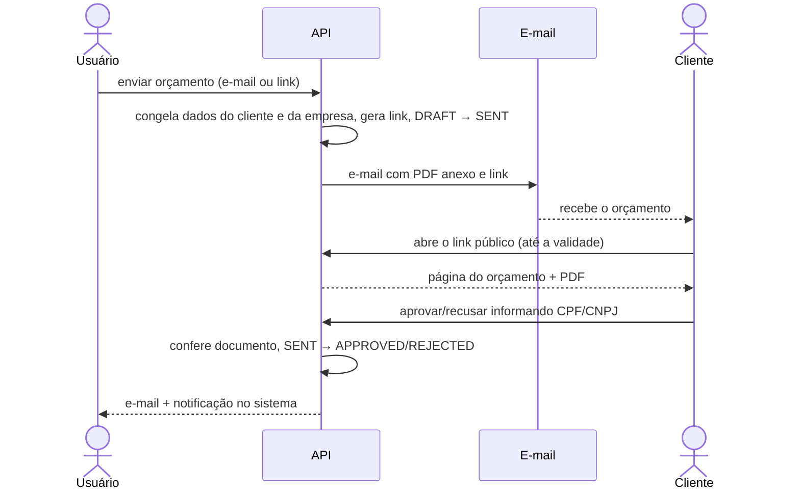

# Domínio — Especificação: Envio do Orçamento

> **Escopo:** especificação funcional do **envio do orçamento ao cliente** (Fase 6 do [roadmap](./roadmap.md#fase-6--envio-do-orçamento-ao-cliente)): geração de PDF, envio por e-mail, link público, aprovação/recusa pelo cliente, notificações ao usuário e histórico de envio. O envio por WhatsApp (Fase 7) aparece só como canal previsto.
> **Documentos relacionados:** [`budgets.md`](./budgets.md) · [`business-rules.md`](./business-rules.md) · [`roadmap.md`](./roadmap.md) · [`glossary.md`](./glossary.md) · [`../infrastructure/security.md`](../infrastructure/security.md)
> **Fonte da verdade:** especificação validada pelo responsável pelo produto em 2026-10-16.
> **Última revisão:** 2026-10-16.

---

## Status

Tudo neste documento está 🔵 **Aprovado** e ainda **não implementado**. Há uma decisão **em avaliação** (provedor de e-mail — DD2) e uma **a definir** (domínio do link — DD3); veja a seção [Decisões](#13-decisões).

---

## 1. Objetivo

Levar o orçamento até o cliente final em formato apresentável e permitir que ele **responda** (aprove ou recuse) sem precisar de conta no sistema, avisando o usuário quando isso acontecer.

### Regras de outros documentos que o envio cumpre

| Regra | Resumo |
|---|---|
| Decisão R2 | A primeira versão tem **PDF, e-mail e link público**. |
| RN-O03, RN-O15 | Só envia com pelo menos um item; pode enviar com item a combinar (total parcial). |
| RN-O07 | Enviar faz a transição `DRAFT → SENT`. |
| RN-O08 | `SENT` com validade vencida vira `EXPIRED`. |
| RN-O09, RN-O32 | O cliente pode aprovar/recusar pelo link, identificando-se pelo CPF/CNPJ, com tentativas limitadas. |
| RN-O26 | Orçamento enviado não pode ser editado. |
| RN-O29, RN-O30 | Dados do cliente e da empresa são congelados no envio. |
| RN-U16 | Dados da empresa (nome fantasia, telefone, e-mail comercial, endereço, logotipo) aparecem no orçamento. |
| RN-W01, A1 | WhatsApp: um número por conta; forma de integração ainda não decidida (Fase 7). |

---

## 2. Visão geral



---

## 3. O que é "enviar"

**RN-E01 — Primeiro envio.** O primeiro envio por qualquer canal (e-mail, link ou marcação manual) faz `DRAFT → SENT`, registra `sentAt`, congela os dados do cliente e da empresa (RN-O29, RN-O30) e gera o link público.

**RN-E02 — Requisitos para enviar.** Orçamento em `DRAFT` ou `SENT`, com pelo menos um item (RN-O03) e validade definida e não vencida.

**RN-E03 — Reenvio.** Um orçamento `SENT` pode ser **reenviado** quantas vezes for preciso (outro e-mail, o mesmo link novamente). O conteúdo é sempre o congelado no primeiro envio.

**RN-E04 — Envio manual.** O usuário pode baixar o PDF e enviá-lo por conta própria; nesse caso ele **marca como enviado** (canal `MANUAL`), com o mesmo efeito da RN-E01. Usa o `PATCH /budgets/:id/status` com `SENT` de [`budgets.md`](./budgets.md#9-endpoints).

**RN-E05 — Status finais não enviam.** Orçamentos `APPROVED`, `REJECTED`, `EXPIRED` ou `CANCELED` não podem ser enviados nem reenviados, mas o usuário continua podendo baixar o PDF.

---

## 4. PDF do orçamento

**RN-E06 — Conteúdo do PDF.**
1. **Cabeçalho:** logotipo e dados da empresa (nome fantasia ou nome da conta, CPF/CNPJ, telefone, e-mail comercial, endereço).
2. **Identificação:** código (`ORC-0001`), título, data de emissão (envio) e validade.
3. **Cliente:** nome, CPF/CNPJ, e-mail, telefone e endereço.
4. **Itens:** posição, nome, descrição, quantidade, preço unitário, desconto e total de cada item; itens a combinar com o texto "A combinar".
5. **Totais:** subtotal, desconto, acréscimo (com descrição) e total — com o aviso "**Total parcial**: há itens a combinar" quando for o caso.
6. **Observações ao cliente** (`customerNotes`).
7. **Rodapé:** "Orçamento válido até DD/MM/AAAA" e "Gerado pelo OrçaFácil".

**RN-E07 — Nunca mostrar dados internos.** Observações internas (`notes`) de orçamento, produtos e clientes **nunca** aparecem no PDF nem no link público.

**RN-E08 — Pré-visualização de rascunho.** O PDF pode ser gerado também em `DRAFT`, para conferência, com a marca d'água **"RASCUNHO"** e usando os dados atuais (ainda não congelados).

**RN-E09 — Geração sob demanda.** O PDF é gerado **a cada download** a partir dos dados do orçamento (congelados após o envio), **sem armazenar arquivos** (decisão DD1).

**RN-E10 — Formatação.** Valores em reais (`R$ 1.234,56`), datas `DD/MM/AAAA` no fuso `America/Sao_Paulo` (RN-G12), CPF/CNPJ com máscara.

---

## 5. Envio por e-mail

**RN-E11 — Destinatário.** Por padrão, o e-mail do cliente. O usuário pode informar outro endereço (ou mais de um, até 5) no momento do envio. Sem e-mail no cliente e sem endereço informado, o envio por e-mail não é possível.

**RN-E12 — Conteúdo do e-mail.** Assunto: `Orçamento ORC-0001 — {nome da empresa}`. Corpo: saudação ao cliente, mensagem opcional escrita pelo usuário (até 1000 caracteres), resumo (total e validade), **botão para o link público** e o **PDF anexo**.

**RN-E13 — Remetente.** O e-mail sai do endereço do sistema (OrçaFácil), com **nome de exibição da empresa** e **"responder para"** (`Reply-To`) o e-mail comercial do usuário (RN-U16), ou o e-mail da conta se não houver. *(O provedor de envio está em avaliação — DD2.)*

**RN-E14 — Falha no envio.** Se o e-mail falhar, o orçamento **não** muda de status, o histórico registra a falha e o usuário recebe o erro para tentar de novo.

**RN-E15 — Limite de envios.** No máximo **10 e-mails de orçamento por minuto** por usuário (proteção contra spam e contra o limite do provedor).

---

## 6. Link público

**RN-E16 — Token secreto e link curto.** Cada orçamento enviado tem um **token aleatório de 16 bytes** (128 bits, `crypto.randomBytes`), codificado em base64url (**22 caracteres**), impossível de adivinhar. O link é curto: `https://{domínio}/o/{token}` (decisão DD3); a página do frontend consulta a API pública.

**RN-E17 — O que o link mostra.** O mesmo conteúdo do PDF (RN-E06), o status atual do orçamento e um botão para baixar o PDF. Sem dados internos (RN-E07).

**RN-E18 — Validade do link.** O link funciona **somente até a validade** do orçamento (até o fim do dia de `validUntil`, no fuso `America/Sao_Paulo`). Depois disso, a página informa que o orçamento não está mais disponível, mesmo que ele tenha sido aprovado ou recusado.

**RN-E19 — Link desativado.** Orçamento **cancelado** desativa o link imediatamente (a página informa "Este orçamento não está mais disponível").

**RN-E20 — Regerar link.** O usuário pode **regerar** o link (novo token); o anterior deixa de funcionar. Útil se o link foi enviado para a pessoa errada.

**RN-E21 — Registro de visualização.** O sistema registra a **primeira** e a **última** visualização do link (`firstViewedAt`, `lastViewedAt`) e mostra ao usuário que o cliente abriu o orçamento.

**RN-E22 — Documento mascarado.** Na página pública, o CPF/CNPJ do cliente aparece mascarado (ex.: `***.456.789-**`), já que quem tem o link pode não ser o cliente.

---

## 7. Aprovação e recusa pelo cliente

Pelo link, com identificação por CPF/CNPJ e tentativas limitadas (RN-O09, RN-O32).

**RN-E23 — Quando é possível.** Somente com o orçamento `SENT` e dentro da validade. Em qualquer outro status, a página mostra o status atual e não exibe os botões.

**RN-E24 — Confirmação.** O cliente informa o CPF/CNPJ (com ou sem máscara), escolhe "Aprovar" ou "Recusar" e, na recusa, pode escrever um motivo (até 255). A resposta é **definitiva**.

**RN-E25 — Limite de tentativas.** No máximo **5 tentativas erradas** de CPF/CNPJ por link a cada **15 minutos**; ao exceder, o link bloqueia a resposta temporariamente (a visualização continua).

**RN-E26 — Aviso por e-mail.** Quando o cliente aprova ou recusa, o usuário recebe um **e-mail** avisando (com o código do orçamento, o cliente e o motivo, se houver).

**RN-E27 — Registro.** A resposta registra data, `respondedBy: CLIENT`, o motivo e o histórico (canal `LINK`).

**RN-E30 — Notificação no sistema.** Além do e-mail, o usuário recebe uma **notificação dentro do sistema** (decisão DD4) quando o cliente **aprova** ou **recusa** um orçamento. As notificações:
- ficam numa lista própria do usuário, da mais recente para a mais antiga, com indicação de **lida/não lida** e a contagem de não lidas (para o "sino" do frontend);
- levam ao orçamento correspondente;
- podem ser marcadas como lidas uma a uma ou todas de uma vez;
- são excluídas automaticamente após **90 dias**.

---

## 8. Histórico de envio

**RN-E28 — O que é registrado.** Cada envio, reenvio, falha, visualização e resposta do cliente gera um registro no histórico do orçamento, visível ao usuário em ordem cronológica.

| Campo | Conteúdo |
|---|---|
| `channel` | `EMAIL`, `LINK`, `MANUAL` (e `WHATSAPP` na Fase 7) |
| `event` | `SENT`, `FAILED`, `VIEWED`, `APPROVED`, `REJECTED` |
| `recipient` | E-mail(s) de destino (no `EMAIL`) |
| `message` | Mensagem personalizada enviada (no `EMAIL`) |
| `error` | Motivo da falha (no `FAILED`) |
| `createdAt` | Data/hora do evento |

---

## 9. WhatsApp (Fase 7)

Fora do escopo desta fase. Quando a decisão **A1** for tomada, o WhatsApp entra como mais um canal: envia o PDF (e o link) para o telefone do cliente pelo número conectado do usuário (RN-W01), com o mesmo efeito de "enviar" (RN-E01) e registro no histórico (`WHATSAPP`). A especificação detalhada ficará em `whatsapp.md`.

---

## 10. Endpoints

### Autenticados (usuário)

| Método e rota | Uso | Rate limit |
|---|---|---|
| `GET /budgets/:id/pdf` | Baixar o PDF (com marca d'água se `DRAFT`) | 20 / 60 s |
| `POST /budgets/:id/send-email` | Enviar por e-mail. Body: `{ "to": ["..."], "message": "..." }` (ambos opcionais) | 10 / 60 s |
| `POST /budgets/:id/share-link` | Obter o link público (gera e envia o orçamento, se ainda `DRAFT`) | 30 / 60 s |
| `POST /budgets/:id/share-link/regenerate` | Regerar o link (RN-E20) | 10 / 60 s |
| `GET /budgets/:id/dispatches` | Histórico de envio | 120 / 60 s |
| `GET /notifications` | Listar notificações (paginado), com a contagem de não lidas | 120 / 60 s |
| `PATCH /notifications/:id/read` | Marcar uma notificação como lida | 60 / 60 s |
| `PATCH /notifications/read-all` | Marcar todas como lidas | 30 / 60 s |

A marcação manual (RN-E04) usa o `PATCH /budgets/:id/status` já previsto em [`budgets.md`](./budgets.md#9-endpoints).

### Públicos (cliente, sem login)

| Método e rota | Uso | Rate limit |
|---|---|---|
| `GET /public/budgets/:token` | Dados do orçamento para a página pública | 60 / 60 s |
| `GET /public/budgets/:token/pdf` | Baixar o PDF | 10 / 60 s |
| `POST /public/budgets/:token/approve` | Aprovar. Body: `{ "cnpjCpf": "..." }` | 5 / 60 s |
| `POST /public/budgets/:token/reject` | Recusar. Body: `{ "cnpjCpf": "...", "reason": "..." }` | 5 / 60 s |

As rotas públicas **não** usam `authenticate`; o token do link é a única credencial. São uma exceção documentada à regra do README de "rotas com dados sensíveis usam `authenticate`", compensada pelas proteções da seção 11.

---

## 11. Segurança

**RN-E29 — Proteções do link público.**
- Token com 128 bits de aleatoriedade (RN-E16), comparado sem vazar informação de tempo.
- Rate limit por IP mais restrito nas rotas públicas (seção 10).
- Tentativas de CPF/CNPJ contadas no Redis (`budget-approval-attempts-{token}`, TTL 15 min — RN-E25).
- Resposta idêntica para token inexistente, cancelado ou vencido ("não disponível"), sem revelar qual é o caso.
- Nenhum dado interno exposto (RN-E07) e documento mascarado (RN-E22).
- Cabeçalho `X-Robots-Tag: noindex` nas respostas públicas, para buscadores não indexarem orçamentos.
- O token **não** aparece em logs.

---

## 12. Modelo de dados

```prisma
enum DispatchChannel {
  EMAIL
  LINK
  MANUAL
  WHATSAPP   // Fase 7
}

enum DispatchEvent {
  SENT
  FAILED
  VIEWED
  APPROVED
  REJECTED
}

enum NotificationType {
  BUDGET_APPROVED
  BUDGET_REJECTED
}

// Campos novos em Budget
model Budget {
  // ...campos de budgets.md
  publicToken    String?   @unique @db.VarChar(32)   // RN-E16 (22 caracteres)
  publicTokenAt  DateTime?                          // geração/regeração
  firstViewedAt  DateTime?                          // RN-E21
  lastViewedAt   DateTime?                          // RN-E21
  dispatches     BudgetDispatch[]
  notifications  Notification[]
}

model BudgetDispatch {
  id         Int             @id @default(autoincrement())
  channel    DispatchChannel
  event      DispatchEvent
  recipient  String?         @db.VarChar(1000)   // e-mails separados por vírgula
  message    String?         @db.VarChar(1000)
  error      String?         @db.VarChar(255)
  createdAt  DateTime        @default(now())

  budget   Budget @relation(fields: [budgetId], references: [id], onDelete: Cascade)
  budgetId Int

  @@index([budgetId, createdAt])
  @@map("budget_dispatches")
}

model Notification {                       // RN-E30
  id        Int              @id @default(autoincrement())
  type      NotificationType
  title     String           @db.VarChar(100)
  message   String           @db.VarChar(255)
  readAt    DateTime?
  createdAt DateTime         @default(now())

  user     User    @relation(fields: [userId], references: [id], onDelete: Cascade)
  userId   Int
  budget   Budget? @relation(fields: [budgetId], references: [id], onDelete: Cascade)
  budgetId Int?

  @@index([userId, readAt])
  @@map("notifications")
}
```

- Para visualizações frequentes, `VIEWED` pode ser registrado no histórico só na primeira visualização de cada dia, para não inflar a tabela.
- A limpeza de notificações com mais de 90 dias (RN-E30) pode ser feita por uma rotina diária.
- As notificações ficam num módulo próprio (`src/modules/notifications/`), para poderem ser reutilizadas por outros eventos no futuro.

---

## 13. Decisões

Decisões tomadas na revisão de 2026-10-16.

| ID | Pergunta | Decisão |
|---|---|---|
| **DD1** | PDF gerado a cada download ou armazenado? | **Sob demanda**, sem armazenar (RN-E09). |
| **DD2** | Provedor de e-mail para os orçamentos? | **Em avaliação:** verificar a viabilidade de usar o SMTP do Gmail. |
| **DD3** | O link público deve ser curto? | **Sim** (RN-E16). O domínio do frontend ainda será definido. |
| **DD4** | Haverá notificação dentro do sistema? | **Sim** (RN-E30). |
| **DD5** | Até quando o link funciona? | **Só até a validade** do orçamento — RN-E18, opção C. |

### DD2 — pontos para a avaliação do Gmail

Antes de implementar o envio por e-mail, avaliar se o SMTP do Gmail atende:

- **Limites de envio:** cerca de **500 destinatários por dia** numa conta Gmail comum e cerca de **2.000** no Google Workspace. Como todos os usuários do OrçaFácil enviariam pela mesma conta, o limite é compartilhado entre todos.
- **Entrega:** e-mails de uma conta Gmail genérica com o nome de outra empresa no remetente tendem a cair em spam; um domínio próprio com SPF, DKIM e DMARC melhora a entrega.
- **Bloqueio:** envio em volume para destinatários desconhecidos pode levar o Google a suspender a conta, interrompendo também os códigos de cadastro e recuperação de senha, que usam a mesma conta.
- **Alternativa:** serviços transacionais (ex.: Amazon SES, Resend, Brevo) têm planos gratuitos ou baratos para esse volume e não exigem mudar a regra RN-E13.

### Propostas descartadas

| Proposta | Situação |
|---|---|
| RN-E18 opções A (até 30 dias após a validade) e B (enquanto o orçamento existir) | Descartadas (DD5) |
| Gerar o PDF uma vez e armazenar | Descartada (DD1) |
| Token de 32 bytes (43 caracteres) | Substituído por 16 bytes (22 caracteres) para o link ser curto (DD3) |
