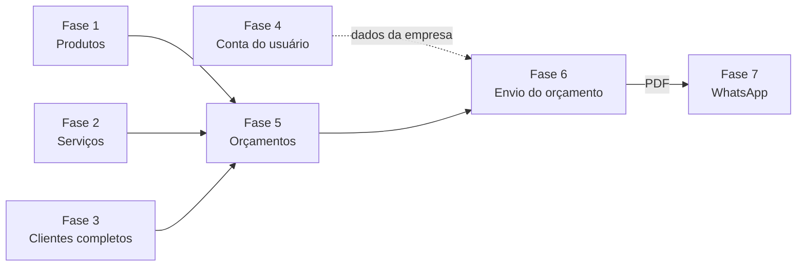

# Domínio — Roadmap

> **Escopo:** evolução planejada do produto: quais **módulos e funcionalidades novas** serão construídos, em que ordem e com quais dependências. Cada entrega aponta para as regras de [`business-rules.md`](./business-rules.md) que ela implementa.
> **Fora deste documento:** correções do que já existe (bugs, segurança, build, deploy, CI). Elas ficam em [`../project/issues.md`](../project/issues.md) e são tratadas à parte.
> **Documentos relacionados:** [`business-rules.md`](./business-rules.md) · [`glossary.md`](./glossary.md) · [`../project/overview.md`](../project/overview.md)
> **Fonte da verdade:** plano validado pelo responsável pelo produto em 2026-10-15.
> **Última revisão:** 2026-10-16.

---

## Como usar e manter

- **Caixas de seleção indicam progresso:** `[ ]` = pendente, `[x]` = concluída. Ao terminar uma entrega, marque `[x]`.
- Atualize a coluna **Situação** da tabela de fases: `Não iniciada` → `Em andamento` → `Concluída`.
- Uma fase só é **Concluída** quando o critério "Concluída quando" for cumprido.
- Mudanças de escopo ou de ordem exigem decisão do responsável pelo produto, registrada na seção [Decisões](#decisões).
- Para pedidos genéricos ("continue o projeto", "qual o próximo passo?"), a IA deve propor a próxima entrega pendente de uma fase cujas dependências estejam concluídas.

---

## Visão geral

| Fase | Funcionalidade | Depende de | Situação |
|---|---|---|---|
| 1 | Catálogo de produtos | — | **Em andamento** (branch `features/products`) |
| 2 | Catálogo de serviços | — | Não iniciada |
| 3 | Clientes completos (endereço, observações, inativação, busca) | — | Não iniciada |
| 4 | Conta do usuário (termos, perfil, senha, dados da empresa, exclusão) | — | Não iniciada |
| 5 | Orçamentos | 1, 2, 3 | Não iniciada |
| 6 | Envio do orçamento: PDF, e-mail e link público | 4, 5 | Não iniciada |
| 7 | Integração com WhatsApp (instância do usuário e envio do PDF) | 6 | Não iniciada |

- As fases 1 a 4 são independentes e **não têm prioridade entre si** (decisão R1): podem ser feitas em qualquer ordem ou em paralelo.
- A Fase 5 precisa do catálogo (produtos e serviços) e dos clientes prontos.
- O **frontend é desenvolvido em paralelo** (decisão R4): cada fase deve deixar seus endpoints documentados em [`../api/endpoints.md`](../api/endpoints.md) assim que estiverem prontos.

### Padrões transversais

Algumas regras valem para todos os módulos e devem ser criadas **uma vez**, como padrão reutilizável, no **primeiro módulo que precisar delas**:

- Paginação: 20 por página, máximo 100, mais recentes primeiro (RN-G15).
- Busca por texto parcial, sem diferenciar maiúsculas e acentos (RN-G16).
- Inativação em vez de exclusão para registros com histórico (RN-G14).
- Valores monetários em BRL com 2 casas e arredondamento comercial (RN-G09, RN-G10).

---

## Fase 1 — Produtos

**Objetivo:** o usuário mantém um catálogo de produtos para usar nos orçamentos.

**Situação atual:** CRUD iniciado na branch `features/products` (commit `9b5bc75`).

**Entregas**
- [x] Especificação detalhada em [`products.md`](./products.md).
- [ ] Cadastrar, editar, listar, buscar e ver produtos — RN-P01.
- [ ] Preço maior que zero e com precisão suficiente para valores altos — RN-P02.
- [ ] Categoria e observações internas do produto — [`products.md`](./products.md#3-campos).
- [ ] Nome único entre os produtos ativos do usuário — RN-P04.
- [ ] Inativar produtos (e excluir os que nunca foram usados) — RN-P05, RN-G14.

**Concluída quando:** as regras de produtos estão implementadas (✅), com testes unitários e o RAG atualizado.

---

## Fase 2 — Serviços

**Objetivo:** o usuário mantém um catálogo de serviços (mão de obra, instalação, hora técnica), separado dos produtos (decisão D2).

**Entregas**
- [x] Especificação detalhada em [`services.md`](./services.md).
- [ ] Cadastrar, editar, listar, buscar e ver serviços — RN-S01, RN-S02, RN-S04 a RN-S06.
- [ ] Preço opcional: serviço sem preço é "a combinar"; quando informado, maior que zero — RN-S03.
- [ ] Inativar serviços (e excluir os que nunca foram usados) — RN-G14.

**Concluída quando:** as regras de serviços estão implementadas (✅), com testes unitários e o RAG atualizado.

---

## Fase 3 — Clientes completos

**Objetivo:** o cadastro de clientes passa a ter tudo o que o orçamento precisa e fica fácil de encontrar.

**Entregas**
- [ ] Endereço do cliente (CEP, logradouro, número, complemento, bairro, cidade, UF) — RN-C10.
- [ ] Observações internas do cliente — RN-C11.
- [ ] Inativar clientes (e excluir os que não têm orçamentos) — RN-C09, RN-G14.
- [ ] Busca por nome parcial, CPF/CNPJ, e-mail e telefone, com filtro de ativos/inativos e paginação — RN-C12, RN-G15, RN-G16.

**Concluída quando:** as regras RN-C09 a RN-C12 estão implementadas (✅), com testes unitários e o RAG atualizado.

---

## Fase 4 — Conta do usuário

**Objetivo:** o usuário gerencia a própria conta e os dados da empresa que aparecem nos orçamentos.

**Entregas**
- [ ] Aceite de Termos de Uso e Política de Privacidade no cadastro — RN-U07.
- [ ] Ver e editar perfil (nome; troca de e-mail com confirmação por código; CPF/CNPJ imutável) — RN-U15.
- [ ] Alterar senha logado (senha atual + código por e-mail) — RN-U13.
- [ ] Dados da empresa para documentos (nome fantasia, telefone, e-mail comercial, endereço, logotipo) — RN-U16.
- [ ] Excluir a conta, de forma imediata, com todos os dados — RN-U14, RN-G17.
- [ ] Configurações do usuário: validade padrão dos orçamentos (padrão 15 dias) — RN-O31.

**Concluída quando:** as regras RN-U07 e RN-U13 a RN-U16 estão implementadas (✅) e o módulo `user` tem rotas documentadas.

---

## Fase 5 — Orçamentos

**Objetivo:** o usuário cria, edita e acompanha orçamentos para seus clientes, com produtos e serviços.

**Entregas**
- [x] Especificação detalhada em [`budgets.md`](./budgets.md).
- [ ] Status e transições (rascunho, enviado, aprovado, recusado, expirado, cancelado), com expiração automática — RN-O07, RN-O08, RN-O10, RN-O11.
- [ ] Sem edição após o envio; cancelar em vez de excluir — RN-O26, RN-O28.
- [ ] Criar orçamento para um cliente, com itens de produtos e serviços do próprio catálogo — RN-O01, RN-O02.
- [ ] Nome e preço dos itens congelados no momento da inclusão — RN-O04, RN-G13.
- [ ] Numeração sequencial por usuário — RN-O05.
- [ ] Cálculo de subtotais, descontos e total, sem valores negativos — RN-G09, RN-G10, RN-O06.
- [ ] Envio permitido apenas com ao menos um item — RN-O03.
- [ ] Clientes, produtos e serviços usados em orçamentos passam a só poder ser inativados — RN-C09, RN-P05, RN-G14.
- [ ] Listagem com busca e filtros (status, cliente, período).

**Concluída quando:** `budgets.md` aprovado e implementado, regras RN-O01 a RN-O32 em ✅, testes unitários e RAG atualizado.

---

## Fase 6 — Envio do orçamento ao cliente

**Objetivo:** entregar o orçamento ao cliente final em um formato apresentável. A primeira versão inclui **os três formatos** abaixo (decisão R2).

**Entregas**
- [x] Especificação detalhada em [`dispatch.md`](./dispatch.md).
- [ ] Geração de **PDF** do orçamento com os dados da empresa (RN-U16) e do cliente, sob demanda — RN-E06 a RN-E10.
- [ ] **Envio por e-mail** ao cliente, com o PDF anexo.
- [ ] **Link público** curto de visualização do orçamento, válido até a validade — RN-E16 a RN-E22.
- [ ] **Aprovar ou recusar pelo link**, com identificação do cliente pelo CPF/CNPJ — RN-O09, RN-O32.
- [ ] Registro de envio (data e canal: e-mail, link, manual ou WhatsApp) no histórico do orçamento — RN-E28.
- [ ] **Notificações no sistema** quando o cliente aprova ou recusa — RN-E30.

> Antes de implementar o envio por e-mail, concluir a avaliação do provedor (decisão **DD2** de [`dispatch.md`](./dispatch.md#13-decisões)).

**Concluída quando:** PDF, e-mail e link público funcionam de ponta a ponta, o histórico registra cada envio e tudo está documentado.

---

## Fase 7 — Integração com WhatsApp

**Objetivo:** o usuário conecta o próprio WhatsApp ao OrçaFácil e envia orçamentos aos clientes **a partir do seu número**.

**Entregas**
- [ ] Gerar um **QR Code** para o usuário conectar o WhatsApp e criar a sua **instância** (conexão do número com o sistema). Cada conta conecta **um único número** — RN-W01 (decisão R5).
- [ ] **Enviar o PDF** do orçamento por WhatsApp para o cliente, através do número conectado (registrado no histórico de envio da Fase 6).

**Concluída quando:** o usuário conecta o WhatsApp pelo QR Code, envia um orçamento em PDF para um cliente pelo número conectado e o envio aparece no histórico; tudo documentado.

> **Bloqueio:** antes de iniciar esta fase, é preciso decidir **A1** (como a integração será feita). A decisão foi adiada; não implemente a integração sem ela.

---

## Fora do escopo

Funcionalidades que **não** entram no roadmap atual, por decisão de produto:

| Funcionalidade | Motivo |
|---|---|
| Vendas, conversão de orçamento em venda, pagamentos | Decisão D6 |
| Equipe, vendedores, vários usuários por empresa | Decisão D1 |
| Planos pagos e limites por conta | Decisão D3 |

---

## Decisões

Decisões de planejamento tomadas na revisão de 2026-10-15.

| ID | Pergunta | Decisão |
|---|---|---|
| **R1** | Há prioridade entre as fases 1 a 4? | **Não.** Podem ser feitas em qualquer ordem ou em paralelo. |
| **R2** | Quais formatos de envio entram na primeira versão? | **PDF, e-mail e link público**, além do WhatsApp (Fase 7). |
| **R3** | Existe data-alvo de lançamento? | **Não.** |
| **R4** | O frontend será desenvolvido em paralelo? | **Sim.** Os endpoints de cada fase devem ser documentados assim que ficarem prontos. |
| **R5** | Quantos números de WhatsApp cada conta pode conectar? | **Um.** Uma instância por usuário (RN-W01). |

### Decisões em aberto

| ID | Pergunta | Situação | Prazo |
|---|---|---|---|
| **A1** | Como será feita a integração com o WhatsApp? | **Adiada** | Antes de iniciar a Fase 7 |

**A1 — contexto para a decisão.** Conectar por QR Code usa bibliotecas ou serviços **não oficiais**, que imitam o WhatsApp Web (ex.: Baileys, WPPConnect, Evolution API). Elas não têm custo por mensagem, mas violam os termos do WhatsApp e o número pode ser **banido**. A alternativa oficial (WhatsApp Business Cloud API, da Meta) não usa QR Code: exige conta empresarial verificada, modelos de mensagem aprovados e cobra por conversa. A escolha afeta as entregas da Fase 7 (o QR Code só existe na abordagem não oficial).
