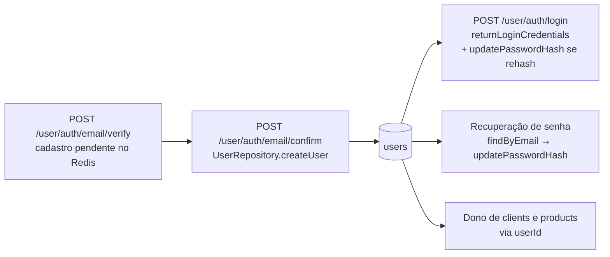

# Módulo `user`

> **Escopo:** responsabilidades, arquivos, estado atual e repositório do módulo de usuários.
> **Documentos relacionados:** [`auth.md`](./auth.md) (principal consumidor do repositório) · [`clients.md`](./clients.md) · [`../database/schema.md`](../database/schema.md#31-users-model-user) · [`../architecture/conventions.md`](../architecture/conventions.md)
> **Fonte da verdade:** `src/modules/user/` no repositório `orcafacil-api`.
> **Última revisão:** 2026-10-15.

---

## 1. Responsabilidade

O módulo `user` é o dono da entidade **`User`** (tabela `users`), que representa a conta que acessa o sistema.

Hoje, seu papel é **ser a camada de acesso a dados de usuários** (`UserRepository`), usada por outros módulos:

- o `auth` cria usuários, busca por e-mail, lê credenciais e atualiza o hash da senha;
- o `clients` verifica se um usuário existe.

A **camada HTTP do módulo ainda não foi implementada**: o router é montado em `/user`, mas não tem rotas; o controller e o service são classes vazias. Funcionalidades como "ver meu perfil" ou "editar meus dados" devem ser implementadas aqui.

> Cadastro, login e senha **não** pertencem a este módulo — são do [`auth`](./auth.md), cujas rotas ficam em `/user/auth`.

---

## 2. Arquivos

| Arquivo | Estado | Conteúdo |
|---|---|---|
| `user.route.ts` | Esqueleto | `UserRoutes = Router()` sem rotas; registrado em `src/index.ts` como `app.use('/user', UserRoutes)`. |
| `user.controller.ts` | Vazio | `export class UserController {}` |
| `user.service.ts` | Vazio | `export class UserService {}` |
| `user.repository.ts` | **Implementado** | `UserRepository` com 5 métodos de acesso à tabela `users`. |
| `user.types.ts` | Implementado | `UserTypes`: `UserComplete`, `UserResponse`, `UserCredentials`. |
| `user.dtos.ts` | Implementado (não utilizado) | `UserResponseDTO { email, name, created_at, updated_at }`. |

Não há `user.schema.ts` (não existem rotas para validar).

---

## 3. Tipos (`user.types.ts`)

| Tipo | Campos | Uso |
|---|---|---|
| `UserComplete` | `cnpjCpf`, `email`, `name`, `password` | Entrada de `createUser` (o `password` já chega como hash). |
| `UserResponse` | `id`, `cnpjCpf`, `email`, `name`, `createdAt`, `updatedAt` | Retorno público de usuário — **sem `password`**. |
| `UserCredentials` | `id`, `cnpjCpf`, `email`, `password` | Retorno de `returnLoginCredentials`, usado só no login. |

---

## 4. Repositório (`UserRepository`)

Classe com métodos estáticos; cada um envolve uma operação Prisma em `try/catch` e converte falhas em `AppError` 500.

| Método | Operação | Retorno | Erro em falha (500) | Usado por |
|---|---|---|---|---|
| `findByEmail(email)` | `prisma.user.findUnique({ where: { email }, select: … })` | `UserResponse \| null` | `QUERY_DATABASE_ERROR` | `auth.verifyEmail`, `auth.sendCodeRecovery` |
| `findById(id)` | `prisma.user.findUnique({ where: { id }, select: … })` | `UserResponse \| null` | `QUERY_DATABASE_ERROR` | `clients.edit` |
| `createUser(data)` | `prisma.user.create({ data: { cnpjCpf, email, name, password } })` | `UserResponse` | `USER_CREATION_FAILED` | `auth.confirmEmail` |
| `returnLoginCredentials(email)` | `prisma.user.findUnique({ where: { email }, select: { id, cnpjCpf, email, password } })` | `UserCredentials \| null` | `QUERY_DATABASE_ERROR` | `auth.login` |
| `updatePasswordHash(userId, hash)` | `prisma.user.update({ where: { id }, data: { password } })` | `void` | `UPDATE_DATABASE_ERROR` | `auth.login` (rehash), `auth.createNewPassword` |

### Regras do repositório

- **A senha nunca sai do repositório**, exceto em `returnLoginCredentials`. Os demais métodos usam `select` explícito e/ou montam o objeto de retorno campo a campo, sem `password`.
- O repositório **não faz hash**: recebe a senha já processada pelo `ArgonHash` no service do `auth`.
- Buscas retornam `null` quando o usuário não existe; quem decide se isso é erro é o service que chamou.
- E-mail e CPF/CNPJ são únicos no banco (`users_email_key`, `users_cnpjCpf_key`).

---

## 5. Ciclo de vida de um usuário

1. **Criação:** só acontece em `auth.confirmEmail`, depois da verificação do e-mail.
2. **Autenticação:** o `id` do usuário vira o `sub` dos JWTs e chega às rotas protegidas em `req.user`.
3. **Posse de dados:** clientes e produtos referenciam o usuário por `userId` (ver [`../database/relationships.md`](../database/relationships.md)).
4. **Alteração:** hoje, apenas o hash da senha é alterado (rehash no login ou recuperação de senha).
5. **Exclusão:** não existe endpoint. No banco, excluir um usuário com clientes ou produtos é bloqueado (`ON DELETE RESTRICT`).

---

## 6. Como evoluir o módulo

Ao adicionar rotas de usuário (ex.: perfil, edição de dados):

1. Criar `user.schema.ts` com os schemas Zod.
2. Implementar métodos em `UserController` e `UserService` seguindo o padrão do [`clients`](./clients.md).
3. Registrar as rotas em `UserRoutes` com `rateLimit` → `authenticate` → `validateSchema` → controller.
4. Usar **sempre** `Number(req.user)` como id do usuário (o usuário só acessa os próprios dados).
5. Retornar `UserResponse` (nunca `password`).
6. Cuidar para não conflitar com o prefixo `/user/auth`, que pertence ao `auth`.
7. Adicionar códigos na seção `// USER` de `ErrorCodes.ts`.
